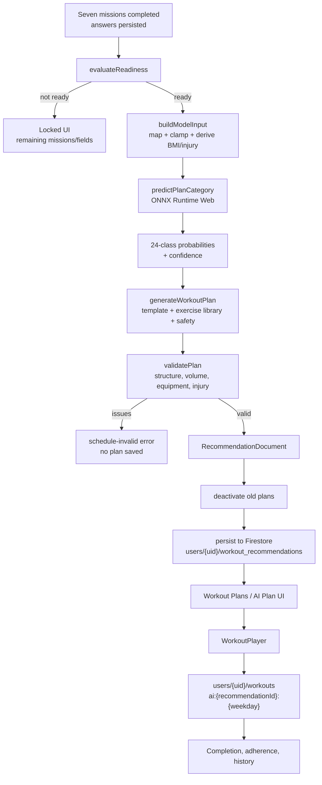
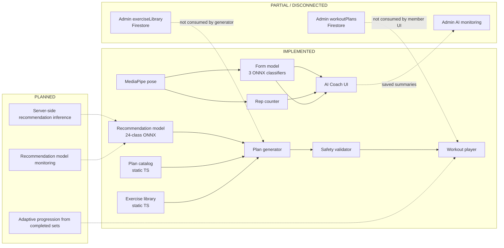

# Forge Athletic — AI/ML Architecture

---

## 1. Inventory

| System | Status | Runtime | Model artifacts | Application entry |
|---|---|---|---|---|
| Exercise-form detection | IMPLEMENTED | Browser (MediaPipe + ONNX Runtime Web) | `public/models/form_classifier_{squat,bicep_curl,push_up}.onnx` | `src/features/ai-coach/**`, `AICoachPage.tsx` |
| Standalone form-model checker | IMPLEMENTED | Browser | same ONNX + `public/model-check-fixture.json` | `public/model-check.html` |
| Workout recommendation | IMPLEMENTED | Browser (ONNX Runtime Web) | `public/models/workout_recommendation.onnx` + schema | `src/features/workout-recommendation/**` |
| Deterministic plan generator | IMPLEMENTED | Browser TypeScript | `exerciseLibrary.ts`, `planCatalog.ts` | `generator.ts` |
| Adaptive progression | NOT PRESENT | — | — | no load/volume adaptation from completed sessions |
| Server-side inference | PLANNED | — | — | no API/inference server |
| Recommendation admin monitoring | NOT PRESENT | — | — | admin monitors form models only |

There is no generative LLM chat in this application.

---

## 2. Exercise-form detection

### 2.1 Artifacts

| File | Size | Purpose |
|---|---:|---|
| `public/models/form_classifier_squat.onnx` | 366 KB | Squat GOOD/BAD classifier |
| `public/models/form_classifier_bicep_curl.onnx` | 333 KB | Bicep-curl GOOD/BAD classifier |
| `public/models/form_classifier_push_up.onnx` | 365 KB | Push-up GOOD/BAD classifier |
| `public/models/model_metadata.json` | 2.0 KB | Version, 60-feature order, class order, thresholds, notes |
| `public/model-check-fixture.json` | — | Frozen features/probabilities for JS-vs-Python parity |
| `ml/reports/final_metrics.json` | — | CV/validation/test metrics, thresholds, ONNX parity |
| `ml/reports/summary.json` | — | Dataset/window/pose-detection summary |
| `ml/reports/splits.json` | — | Subject-level train/val/test splits |

The ONNX models are Random Forest classifiers exported from the Python project. The model metadata declares:

- Unit: one exercise-set clip.
- Feature source: `ml/fitness_features.py`, `ml/experiment_clip.py`, `ml/experiment_repmetry.py`.
- Classes: `["BAD", "GOOD"]`.
- Thresholds: squat `0.66`, bicep curl `0.64`, push-up `0.58`.
- Input: float32 `[N, 60]`; NaN allowed because a median imputer is in the graph.
- Output probabilities columns `[BAD, GOOD]`; compare column 1 to threshold.

### 2.2 Input and feature pipeline

MediaPipe Pose Landmarker produces 33 landmarks. The application samples at **10 Hz** (`lastSampleRef` interval 100 ms) and extracts a 60-feature clip:

- Knee, hip, elbow, shoulder, ankle angle min/max/ROM/std/IQR.
- Torso inclination mean/max/std/ROM.
- Sway std/max absolute/range.
- Knee deviation mean/max/asymmetry mean.
- Knee/ankle width ratios.
- Hip/shoulder height drop ranges.
- Left/right knee and elbow differences.
- Wrist height ranges/maxima.
- Knee/elbow angular velocity.
- Rep features: rate, angle range, period mean/std/CV/min/max, fraction below 25%, above 75%, mid-range, ROM per rep.

Reference implementation: `ml/fitness_features.py`. Browser port: `src/features/ai-coach/lib/featurePipeline.ts`.

The code comments state the maths must remain identical to the Python trainer; `public/model-check.html` includes a parity self-test with a tolerance of `0.05°` for features and checks probability delta.

### 2.3 Inference and classification

`src/features/ai-coach/lib/modelClient.ts`:

1. Fetches `/models/model_metadata.json`.
2. Dynamically imports `onnxruntime-web@1.19.2` from jsDelivr.
3. Creates three `InferenceSession`s from `/models/form_classifier_*.onnx` with WASM execution.
4. `score(exercise, frames)`:
   - Requires at least 20 frames (~2 seconds).
   - Builds the feature vector in metadata order.
   - Runs the session with `float32 [1, 60]`.
   - Reads the output whose name matches `/probab/i`.
   - Takes `pBad = probabilities[0]`, `pGood = probabilities[1]`.
   - `verdict = pGood >= threshold ? 'good' : 'needs-work'`.

### 2.4 Rep counting

`src/features/ai-coach/lib/repCounter.ts` is independent from the classifier:

- Primary joint angle: squat → knee; curl/push-up → elbow.
- Default low/high ranges, adapted dynamically from the 10th/90th percentiles of the last 90 angles when range ≥ 18°.
- Hysteresis: cross below `low` to enter bottom; cross above `high` to count a rep.
- Minimum 280 ms between reps.
- This is motion detection, not a model prediction.

### 2.5 Camera, video, and UI

`AICoachPage.tsx`:

- Requests camera with `getUserMedia({ video: 1280×720 ideal, facingMode: 'user' })`.
- Alternatively loads a local video file into an object URL.
- Draws a 33-point skeleton on a canvas overlay.
- Requires ~80% of exercise-specific landmarks with visibility ≥ 0.25 to consider a pose “ready.”
- Buffers up to 600 frames; scores the latest 180 frames every ~1.8 s when at least 20 frames exist.
- Displays p(GOOD), threshold, verdict, reps, timer, frames, detection rate, and 1–3 measured cues.
- Cues are rule-based from measured ROM, torso lean, left/right difference, and rep rhythm—not model-generated text.

### 2.6 Persistence

Only the session summary is saved, and only on `Save session`:

```text
AISessionRecord
  exercise, exerciseLabel, completedAt, durationSeconds, reps
  scores[] (at most 80 windows)
  averageFormScore, bestFormScore, verdict, source
```

Saved to `users/{uid}/ai_sessions` and localStorage. Camera frames and landmarks are not persisted or uploaded.

### 2.7 Measured performance

From `ml/reports/final_metrics.json`:

| Exercise | CV 5-fold accuracy | Validation accuracy | Test accuracy | Test ROC-AUC | Threshold | ONNX parity max abs diff |
|---|---:|---:|---:|---:|---:|---:|
| Squat | 0.573 | 0.625 | 0.500 | 0.653 | 0.66 | 5.19e-7 |
| Bicep curl | 0.527 | 0.500 | 0.500 | 0.431 | 0.64 | 5.43e-7 |
| Push-up | 0.701 | 0.750 | 0.625 | 0.736 | 0.58 | 6.32e-7 |

The UI correctly labels this as a secondary signal with modest held-out accuracy. It must not be presented as a clinical or definitive form assessment.

### 2.8 Standalone checker

`public/model-check.html` / `run-model-check.bat`:

- Select exercise, start camera or load a video, buffer frames, analyse a set.
- Runs the same JS feature extraction and ONNX sessions.
- Self-test compares browser features/probabilities against `model-check-fixture.json`.
- Useful for model/parity debugging; not linked from the member dashboard.

### 2.9 Form-inference workflow

```mermaid
sequenceDiagram
  participant U as User
  participant P as AICoachPage
  participant M as MediaPipe
  participant F as FeaturePipeline
  participant O as ONNX Runtime
  participant R as RepCounter
  participant S as Activity Store

  U->>P: Start camera / load video
  P->>M: Load vision bundle + pose task
  loop ~10 samples/sec
    P->>M: detectForVideo(frame)
    M-->>P: 33 landmarks
    P->>P: visibility gate + skeleton overlay
    P->>R: primary joint angle
    R-->>P: rep count
    P->>P: buffer up to 600 frames
  end
  every ~1.8s
    P->>F: latest 180 frames
    F-->>P: 60-feature vector
    P->>O: run exercise ONNX session
    O-->>P: p(BAD), p(GOOD)
    P->>P: threshold -> GOOD / needs-work + cues
  end
  U->>P: Finish set, Save session
  P->>S: addAISession(summary)
  S->>S: Firestore ai_sessions + localStorage
```

---

## 3. Workout recommendation

### 3.1 Artifacts

| File | Size | Purpose |
|---|---:|---|
| `workout-recommendation/artifacts/workout_recommendation.onnx` | 1,617,299 bytes | Full preprocessing + classifier pipeline |
| `public/models/workout_recommendation.onnx` | 1.6 MB | Served copy generated by `copy-model-assets.mjs` |
| `workout-recommendation/artifacts/feature_schema.json` / `public/models/feature_schema.json` | 3.6 KB | Input/output schema + 24 labels |
| `workout-recommendation/artifacts/model_metadata.json` | — | Training/exporter metadata |
| `workout-recommendation/artifacts/training_results.json` | 47 KB | Metrics, confusion matrix, per-class results |
| `workout-recommendation/artifacts/onnx_validation.json` | 3.4 KB | Parity, determinism, latency, edge cases |

### 3.2 Model contract

Inputs:

| Name | Type | Source |
|---|---|---|
| `Age` | float32 | Quick Start age, clamped 20–66 |
| `Weight_kg` | float32 | Body Metrics weight, clamped 40–120 |
| `Height_cm` | float32 | Quick Start height, clamped 150–205 |
| `BMI` | float32 | Derived: weight / (height/100)² |
| `Gender` | string | Body Metrics gender: Male/Female/Unspecified |
| `Goal` | string | Mapped to dataset goals |
| `Equipment` | string | Mapped to dataset equipment |
| `Experience` | string | Mapped to Beginner/Intermediate/Advanced |
| `Injury` | string | Derived injury site: None/Knee/Ankle/Shoulder/Back |

Outputs:

```text
label: int64 [N]
probabilities: float32 [N, 24]
```

Target labels (24):

1. 3-Day Full Body Mix
2. 5x3x1 Strength Program
3. 5x5 Compound Lifts
4. Advanced Calisthenics
5. Bodyweight Circuit
6. Core Stability, Yoga & Walking
7. Daily 30-min Bodyweight Flow
8. Dumbbell Upper/Lower Split
9. Full Body Dumbbell Complex
10. HIIT with Dumbbells
11. High Reps Low Weight Sculpting
12. Jump Rope & Burpee Intervals
13. Long Distance Running Plan
14. Lower Body Bodyweight & Hiking
15. Lower Body Power & Stationary Bike
16. Metabolic Resistance Training
17. Olympic Lifting & Plyometrics
18. Push-Pull-Legs Split (Hypertrophy)
19. Seated Upper Body Strength & Rowing
20. Swimming & Upper Body Machines
21. Treadmill Intervals & Circuit Training
22. Upper Body Calisthenics & Core
23. WOD & High Intensity Functional Training
24. Yoga & Mobility Flow

### 3.3 Input mapping

`src/features/workout-recommendation/lib/modelInput.ts`:

| App value | Dataset value |
|---|---|
| fat-loss | Weight Loss |
| muscle | Muscle Gain |
| strength | Strength |
| endurance | Endurance |
| health / longevity | General Health |
| beginner / returning | Beginner |
| intermediate | Intermediate |
| advanced | Advanced |
| gym / studio | Gym Membership |
| home-basic + bands | Full Home Gym |
| home-basic | Home Dumbbells |
| bands / cardio | Bodyweight Only |
| no equipment | Bodyweight Only |

Gender mapping: `male → Male`, `female → Female`, anything else → `Unspecified`.

Injury mapping: free text is keyword-scanned for knee/ankle/shoulder/back terms; only the first derived site enters the model. Medical free text is not sent to the model.

### 3.4 Readiness gating

`evaluateReadiness()` requires:

- Quick Start profile exists.
- All seven missions are `completed`.
- Each completed mission has non-empty persisted answers.
- Required fields per mission are present:
  - body-metrics: weight
  - health-profile: conditions, clearance, emergencyConsent
  - training-history: experience, equipment
  - nutrition-profile: diet
  - lifestyle-check: sleepHours, dailyActivity, stress
  - goal-deep-dive: primaryGoal, timeline, motivation
  - mindset-mission: confidence, coachingStyle, habit, weeklyTime
- Weight 30–300, age 16–90, height 120–230.

The UI lock is therefore based on **persisted answers**, not only completion badges.

### 3.5 Browser inference

`src/features/workout-recommendation/lib/inference.ts`:

- `MODEL_URL = /models/workout_recommendation.onnx`
- `SCHEMA_URL = /models/feature_schema.json`
- ORT `1.31.1` WASM from jsDelivr, one thread.
- Sessions/feature schema cached in module promises.
- Input validation against numeric and categorical ranges.
- Numeric tensors `[1,1]`; categorical string tensors `[1,1]`.
- Label resolved from schema target labels, probabilities sorted.
- Errors are typed: `model-unavailable`, `invalid-input`, `inference-failed`, `schema-unavailable`.

### 3.6 Plan generation

The classifier chooses a category. The actual schedule is produced by `generateWorkoutPlan()` in `lib/generator.ts`, using:

- `PLAN_CATEGORY_MAP` / `PLAN_TEMPLATES` from `data/planCatalog.ts` (24 categories → templates).
- `EXERCISE_LIBRARY` from `data/exerciseLibrary.ts`.
- User profile: age/height/weight/goal/experience/preferred days.
- Mission answers: weekly time, lifestyle, equipment, health, injuries.
- Safety context from derived injury sites and medical clearance.

Generation rules:

1. Resolve session count from template default/max, weekly-time cap, experience cap, and available preferred days.
2. Pick training weekdays, filling from defaults if fewer than needed.
3. For each training day, expand session patterns and choose exercises matching equipment, difficulty, goal tags, and injury exclusions.
4. Guarantee at least two exercises, falling back to available mobility work.
5. Apply per-session dose by template intensity/experience.
6. Apply hard-set volume caps: beginner/returning 18, otherwise 24 per session.
7. Estimate duration from warm-up, sets, work, rest, and experience factor.
8. Add rest days with recovery notes.
9. Run `validatePlan()` before persistence:
   - Exactly 7 days, unique weekdays.
   - ≥1 rest day.
   - ≥2 exercises per training day.
   - ≤90 min/session, ≤26 daily sets, ≤110 weekly sets.
   - No repeated exercise in a session.
   - Valid sets/reps.
   - No injury-excluded exercises.
   - Equipment must be available.
10. Build the `RecommendationDocument` with safety summary, snapshot, confidence, probabilities, version, and `modelSource: 'onnx-web'`.

`WEEKLY_SESSION_CAP`: `2h → 2`, `3-4h → 3`, `5-6h → 4`, `7h+ → 5`.

### 3.7 Evaluation

From `workout-recommendation/artifacts/model_metadata.json` and `onnx_validation.json`:

- Dataset: `Tomertg/SmartFit_Dataset` (MIT), 10,000 source rows, 491 duplicates removed, 9,509 training rows.
- Split: 6,656 train / 1,426 validation / 1,427 test.
- Selected model: Gradient Boosting (Random Forest had equal validation macro-F1 but a 25.7 MB export vs 1.6 MB).
- Test accuracy / macro-F1: 1.0000 / 1.0000.
- ONNX opset 17; 100% label agreement with held-out targets; deterministic; all 24 classes predicted.
- Batch-1 CPU latency ~0.144 ms; browser WASM measured ~14.7–17 ms in the project report.
- Edge cases: unknown/empty categories encode to all-zero one-hot; integer-for-string rejected by ONNX Runtime; `Gender=Unspecified` accepted.

**Interpretation:** the dataset is synthetic and deterministic by input. Perfect scores are not real-world evidence. This is documented in both the training and evaluation reports.

### 3.8 Recommendation workflow



### 3.9 Outdated-plan detection

`isPlanOutdated()` compares a stable serialization of the plan’s `missionSnapshot.answers` against the authoritative current answer subset:

```text
body-metrics: weight, gender
health-profile: conditions, injuries, restrictions, clearance
training-history: experience, equipment
lifestyle-check: sleepHours, stress, dailyActivity
goal-deep-dive: primaryGoal, secondaryGoals, timeline
mindset-mission: weeklyTime, coachingStyle, confidence
```

If they differ, the active plan is flagged outdated; the UI prompts regeneration. Previous plans are retained as version history.

---

## 4. AI system relationship



### Distinctions

- The form classifiers and recommendation classifier are **separate models** with different inputs, artifacts, and runtimes.
- The exercise library used by the plan generator is a static TypeScript catalog, not the admin-managed Firestore `exerciseLibrary`.
- The workout player executes generated sessions but does not feed loads, reps, or completion back into a progression algorithm.
- Admin AI monitoring covers the form classifiers and AI Coach sessions only.
- No model calls an LLM, and no user data is sent to an external AI API.

---

## 5. Privacy and safety boundaries in the AI layer

- Camera frames/landmarks stay in page memory; only summaries are saved.
- Medical free text never enters the recommendation model; only derived injury site/clearance flags affect safety filtering.
- The recommendation model receives body metrics, goal, equipment, experience, and injury category.
- `validatePlan()` enforces equipment and injury exclusions before persistence.
- Health conditions or pending/restricted clearance trigger conservative programming and a professional-review warning.
- This is not medical diagnosis, clearance, or treatment.
