# Forge Athletic — Application Workflows

All workflows below reflect the current source. Where a step is absent or client-only, it is labeled.

---

## 1. Overall application architecture

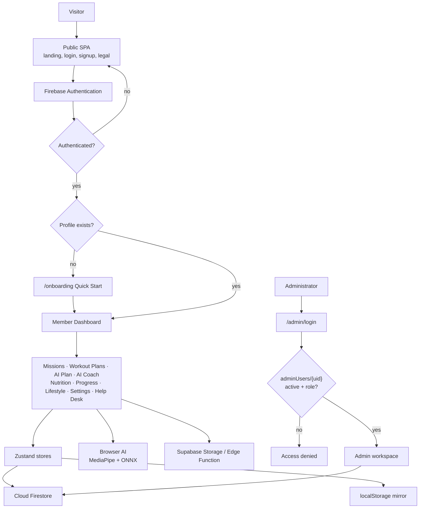

---

## 2. Frontend routing and navigation

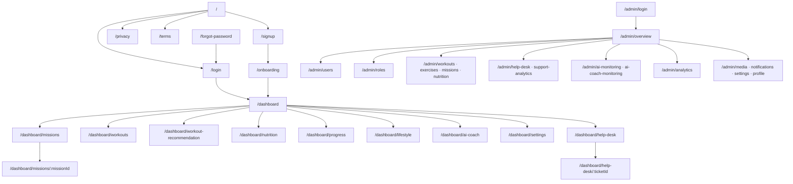

Unknown member paths inside `/dashboard` redirect to `/dashboard`; unknown admin paths redirect to `/admin/overview`; all other paths render the 404 page.

---

## 3. Authentication workflow

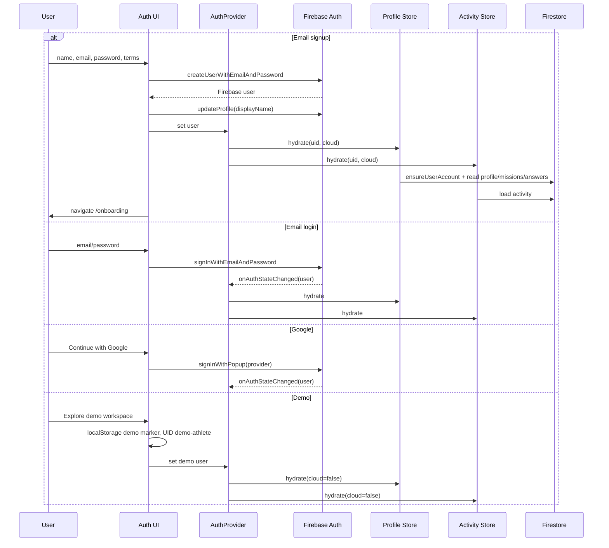

- No email verification is required before dashboard access.
- Password reset sends a Firebase reset email; it is disabled for demo/unconfigured sessions.
- Sign-out clears both stores and the demo marker.
- `PublicOnly` routes redirect an authenticated user to `/dashboard`.
- `DashboardLayout` redirects authenticated users without a profile to `/onboarding`.

---

## 4. User data flow

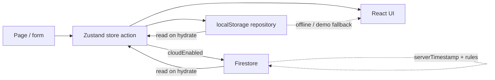

Rules:

1. Local writes happen immediately for responsiveness.
2. Cloud writes happen asynchronously when `cloudEnabled` is true and Firebase is configured.
3. A serialized write queue and 8-second timeout wrapper prevent overlapping writes from racing.
4. On hydration, Firestore data wins when non-empty; local data is migrated to an empty cloud account.
5. If cloud sync fails, the UI remains usable in local mode and shows a banner/error.

---

## 5. My Missions workflow

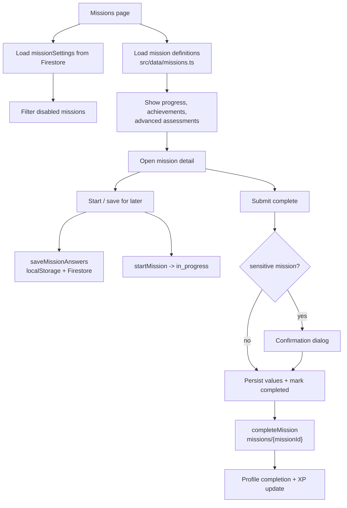

- Mission definitions are static code, not Firestore records.
- All seven missions are initially `available`; no sequential lock is enforced.
- Advanced assessments are visually gated but are not separate routes/forms.
- Health/Nutrition “sensitive” confirmation exists, but the current code still persists the values.
- Body Metrics includes optional gender used by the recommendation model.
- Progress-photo picker is a local preview only.

---

## 6. Workout recommendation workflow

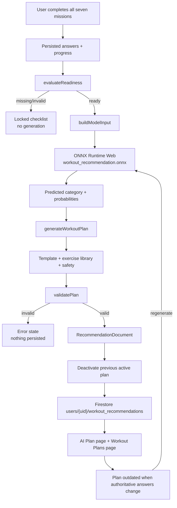

Generation is entirely browser-local. The active plan is cached locally and merged with Firestore history.

---

## 7. AI Coach inference workflow

```mermaid
sequenceDiagram
  participant U as User
  participant UI as AICoachPage
  participant P as PoseLandmarker
  participant F as FeaturePipeline
  participant O as ONNX Runtime
  participant R as RepCounter
  participant S as ActivityStore
  participant DB as Firestore

  U->>UI: Start camera or load video
  UI->>P: Load MediaPipe vision + pose task
  UI->>O: Load 3 form classifiers + metadata
  loop live
    UI->>P: detectForVideo
    P-->>UI: landmarks
    UI->>R: primary angle
    R-->>UI: reps
    UI->>UI: draw overlay, buffer frames
  end
  every ~1.8s
    UI->>F: last 180 frames
    F-->>UI: 60 features
    UI->>O: run selected classifier
    O-->>UI: p(BAD), p(GOOD)
    UI->>UI: threshold -> GOOD/needs-work + cues
  end
  U->>UI: Finish set
  U->>UI: Save session
  UI->>S: addAISession
  S->>DB: users/{uid}/ai_sessions
```

No raw frames leave the browser. Rep counting and form scoring are independent signals.

---

## 8. Workout session persistence

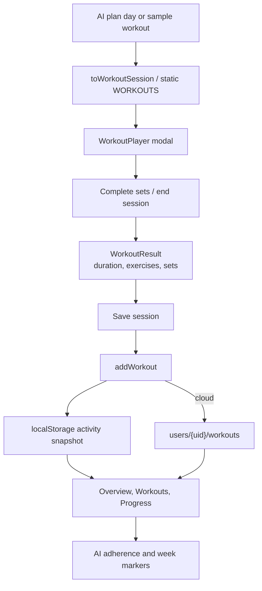

`workoutId` is `ai:{recommendationId}:{weekday}` for AI plans. `completedAiWeekdays()` reads workouts for the current week and maps the suffix back to a weekday.

---

## 9. Progress analytics workflow

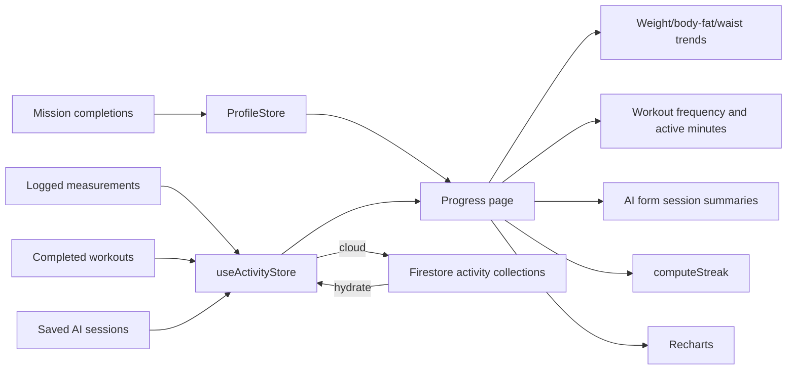

Calculations are in `src/utils/activity.ts`: `startOfWeek`, `workoutsForWeek`, `weeklySeries`, `monthlySeries`, `computeStreak`, `measurementChange`, `sleepSeries`.

There is no predictive analytics or backend aggregation. Admin analytics separately aggregates collection-group reads.

---

## 10. Nutrition and lifestyle workflows

### Nutrition

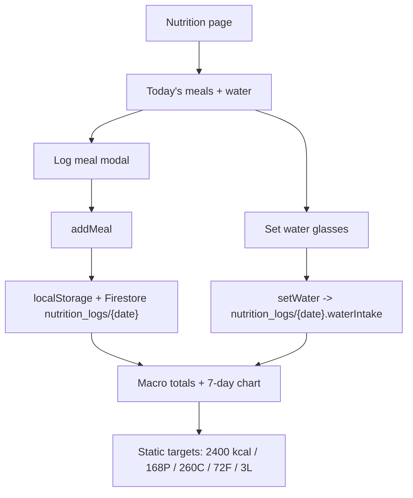

- Meals and water are real user records.
- Targets and the example day are static sample content.
- No nutrition plan is generated from the recommendation model or body metrics.

### Lifestyle

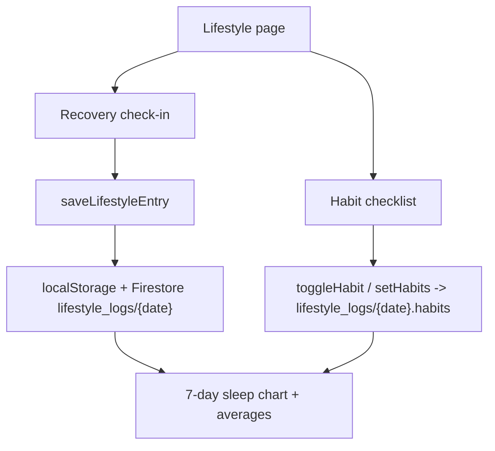

---

## 11. Help Desk workflow

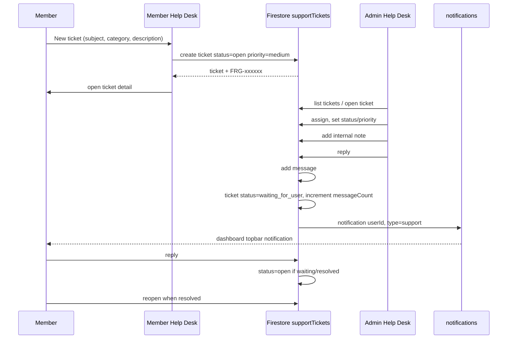

- User sees only own tickets.
- Admin sees all tickets through support permissions.
- Attachments are not implemented.
- No realtime listener; pages reload after writes.
- Internal notes are never exposed to members by rules or UI.

---

## 12. Admin workflow

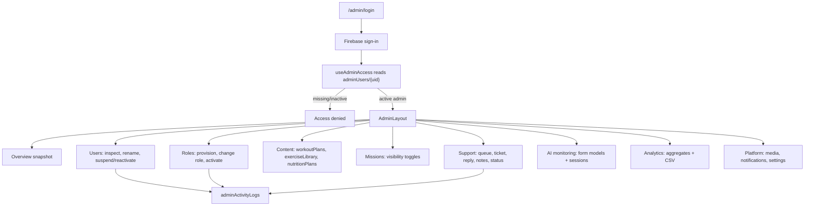

Admin actions are client calls to Firestore. Rules verify `adminUsers` role/active state. The admin role is not a separate auth provider; it is a Firestore record attached to the same Firebase account.

---

## 13. Firebase and Supabase relationships

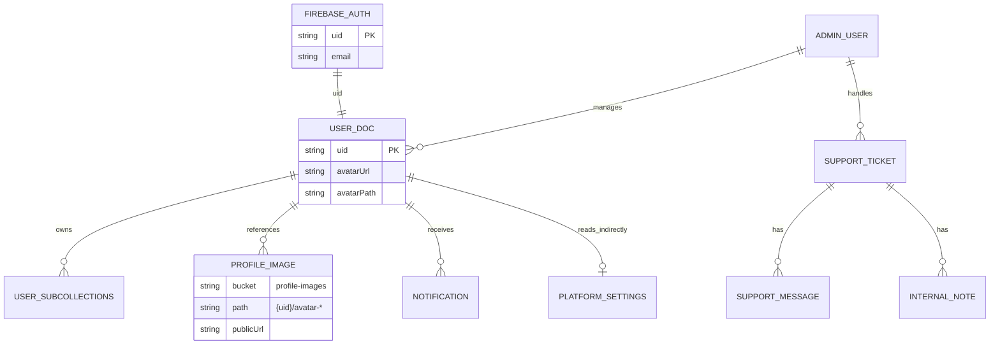

Firestore owns structured data; Supabase owns only the profile image object. The Supabase Edge Function verifies Firebase identity before touching storage.

---

## 14. Profile image workflow

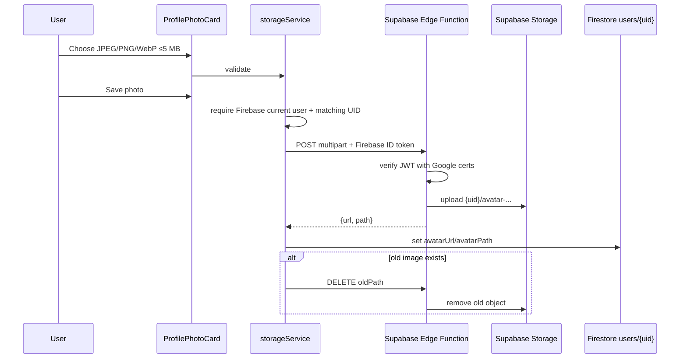

If storage is configured without the function URL, `storageService` falls back to a direct Supabase upload (requires Firebase third-party auth and the storage policies). The preferred path is the Edge Function.

---

## 15. Data reset and deletion workflows

### Reset local profile cache

`resetAllData()`:

- Clears local profile, mission progress, mission answers, and recommendation cache.
- Clears in-memory profile/recommendation stores.
- Does not delete Firestore records.
- Navigates to `/onboarding`.

### Clear activity

`clearActivity()`:

- If cloud enabled, deletes `workouts`, `nutrition_logs`, `progress_records`, `lifestyle_logs`, `ai_sessions`, and defensively `workout_sessions` for the user.
- Clears local activity snapshot.
- Keeps the user profile/missions/answers.

### Account deletion

Not implemented. The UI states that account deletion requires a trusted server operation.
