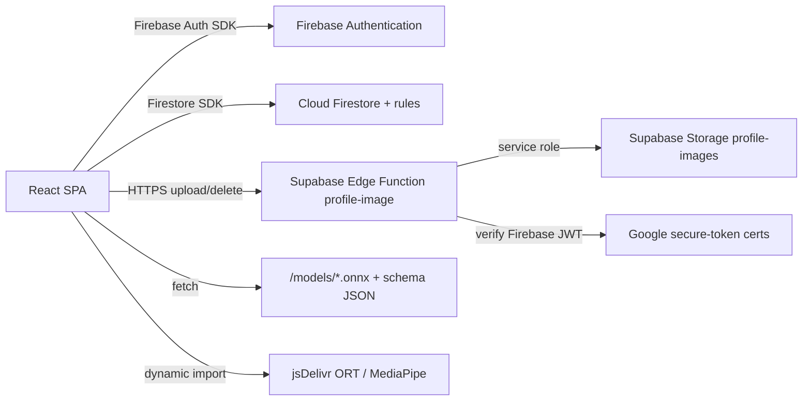

# Forge Athletic — Backend Architecture

---

## 1. Executive finding

**There is no application backend server in this repository.**

Verified facts:

- No `server/`, `api/`, `backend/`, Express/Fastify/Nest/Next server, or serverless API route directory exists.
- `vercel.json` only rewrites all requests to `/index.html`.
- Member/admin pages use the Firebase **client SDK** directly.
- The only server-side executable code is a Supabase Edge Function for profile-image upload/delete.
- AI inference runs in the browser; there is no inference API.

Therefore “backend” below means:

1. Firebase Authentication (managed service).
2. Cloud Firestore (managed database + security rules).
3. Supabase Storage + one Edge Function.
4. Static asset delivery for ONNX models and MediaPipe assets.



---

## 2. Firebase layer

### Initialization

`src/lib/firebase.ts`:

- Reads four public `VITE_FIREBASE_*` values.
- Sets `isFirebaseConfigured` from their presence.
- Initializes `app`, `auth`, `firestore`, and a Google provider only when configured.
- In dev, if `VITE_USE_FIREBASE_EMULATORS === 'true'`, connects Auth to `127.0.0.1:9099` and Firestore to `127.0.0.1:8080`.
- Exposes `missingFirebaseVariables` for configuration notices.

### Authentication

`src/services/authService.ts` wraps:

- `onAuthStateChanged`
- `signInWithEmailAndPassword`
- `createUserWithEmailAndPassword`
- `updateProfile` for display name
- `signInWithPopup` with Google
- `sendPasswordResetEmail`
- `signOut`

Error mapping converts Firebase codes into user-facing messages.

There is no custom token exchange, no session cookie, no server-side session verification for member pages, and no email-verification requirement.

### Firestore access

All member data operations are in `src/services/cloud/firestoreRepository.ts`; admin/support/content operations are in `src/services/cloud/adminRepository.ts`. They call `getDoc`, `getDocs`, `setDoc`, `updateDoc`, `addDoc`, `deleteDoc`, `writeBatch`, and `collectionGroup`.

### Authorization

Authorization is implemented in `firestore.rules`, evaluated by Firestore on every read/write. See `SECURITY_ARCHITECTURE.md` and `DATABASE_SCHEMA.md`.

No application middleware exists between the browser and Firestore.

---

## 3. Supabase Edge Function: `profile-image`

**Path:** `supabase/functions/profile-image/index.ts`  
**Runtime:** Deno / Supabase Edge Functions  
**Deployment command in source:** `supabase functions deploy profile-image --no-verify-jwt`

### Why `--no-verify-jwt`

The function is intentionally deployed without Supabase JWT verification because it verifies **Firebase** ID tokens itself against Google’s public certificates. The comment in source explicitly warns never to expose the service-role key.

### Required function secrets

| Secret | Purpose |
|---|---|
| `FIREBASE_PROJECT_ID` | Expected Firebase token audience/issuer |
| `STORAGE_URL` (or platform `SUPABASE_URL`) | Supabase project URL |
| `STORAGE_SERVICE_ROLE_KEY` (or platform `SUPABASE_SERVICE_ROLE_KEY`) | Server-only storage access |

The function also relies on platform-injected Supabase URL/service role as fallbacks. Values are not in the repository.

### Behavior

1. Handles `OPTIONS` with permissive CORS.
2. Requires `Authorization: Bearer <Firebase ID token>`.
3. Parses the JWT header `kid`, fetches Google secure-token X.509 certificates, caches them by `max-age`, imports the certificate, and verifies issuer/audience/subject with `jose`.
4. Builds a Supabase client with the service role.
5. `DELETE`:
   - Requires JSON `{ path }`.
   - Rejects paths not prefixed with the verified `uid/`.
   - Removes the object from `profile-images`.
6. `POST`:
   - Reads multipart form data.
   - Accepts JPEG, PNG, WebP; max 5 MB; non-empty.
   - Builds path `${uid}/avatar-${timestamp}-${random}.${ext}`.
   - Optionally removes `oldPath` if it starts with `${uid}/`.
   - Uploads without upsert.
   - Returns `{ url, path }`.
7. Returns JSON errors with 400/401/405/413/415/500 status codes.

### Important limitation

The function verifies identity and path ownership but does not verify that the requesting account is the same as the user document being updated. Firestore rules separately restrict `avatarUrl`/`avatarPath` updates to the owner.

---

## 4. Supabase Storage policies

`supabase/storage-policies.sql` establishes:

- Bucket `profile-images`, public read.
- Insert/update/delete restricted to the folder matching the JWT `sub` claim (or `auth.uid()` fallback).

The preferred runtime path is the Edge Function, which uses the service role and therefore bypasses those policies after doing its own ownership checks. Direct browser upload is a fallback in `storageService.ts`.

---

## 5. Static asset and model delivery

| Asset | Delivery |
|---|---|
| Recommendation ONNX | `/models/workout_recommendation.onnx` from `public/models` |
| Recommendation schema | `/models/feature_schema.json` |
| Form ONNX files | `/models/form_classifier_{squat,bicep_curl,push_up}.onnx` |
| Form metadata | `/models/model_metadata.json` |
| ORT WASM/glue | jsDelivr CDN, version pinned in code (recommendation 1.31.1; form coach 1.19.2) |
| MediaPipe vision bundle/WASM | jsDelivr `@mediapipe/tasks-vision@0.10.14` |
| Pose landmarker task | Google Cloud Storage MediaPipe model URL |

Build-time copy:

```text
npm run predev / prebuild
  → node scripts/copy-model-assets.mjs
    → workout-recommendation/artifacts/{workout_recommendation.onnx,feature_schema.json}
    → public/models/
```

`public/models/workout_recommendation.onnx` and `feature_schema.json` are gitignored; a clean checkout must run the copy step or build/deploy pipeline.

---

## 6. API routing and middleware

- **API routing:** none.
- **Application middleware:** none.
- **Request authentication middleware:** none for member data; Firestore rules perform authorization.
- **Server-side input validation:** only the Edge Function’s image validation and JWT checks.
- **Server-side plan validation:** none. The plan generator and `validatePlan()` run in the browser before the client writes the plan.
- **CORS:** the Edge Function allows `*` origins for upload/delete. Firestore and Firebase Auth use their managed endpoints.

---

## 7. Error handling

### Firebase/Firestore

- `friendlyCloudError()` maps permission, disabled API, offline, failed-precondition, and missing-database errors.
- `withTimeout()` wraps cloud operations with an 8-second rejection.
- Profile and activity stores have serialized write queues and sync state/error fields.
- Admin pages catch load errors and render `AdminError`.
- Admin snapshot uses per-query `safe()` fallbacks and returns partial errors rather than failing the whole page.

### Authentication

- `mapAuthError()` maps common Firebase Auth codes.
- `AuthConfigurationError` is raised when Firebase is unconfigured.
- `FriendlyAuthError` wraps user-facing auth failures.

### Storage

- `StorageConfigurationError` and image validation errors.
- The uploader cleans up a newly uploaded object if the Firestore avatar update fails.

### AI

- Recommendation errors are typed (`RecommendationError` / `InferenceError`).
- AI Coach surfaces camera permission, no-camera, camera-in-use, model, and scoring errors inline.
- Failures are not reported to a backend telemetry service.

---

## 8. Deployment model

| Layer | Deployment |
|---|---|
| SPA | Any static host. `vercel.json` rewrites all routes to `index.html` |
| Firebase rules/indexes | `firebase deploy --only firestore` using `firebase.json` |
| Supabase schema/bucket | Manual SQL execution of `supabase/storage-policies.sql` |
| Supabase function | `supabase functions deploy profile-image --no-verify-jwt` |
| Model assets | Produced by `prebuild`; must be present in `public/models` at build time |

The repository does not contain CI/CD configuration, environment provisioning, or deployment verification scripts.

---

## 9. What a future real backend would need to own

These are not implemented; they are documented as the clear boundary of the current architecture:

- Server-side recommendation generation and plan validation.
- Server-side write access to `workout_recommendations` (client writes disabled).
- Server-side mission-answer validation and medical-data access controls.
- Suspended-account enforcement at the data layer.
- Account deletion and storage cleanup.
- Email/push notification delivery.
- Server-side audit/telemetry for AI inference failures.
- Trusted admin operations that require the Admin SDK.
