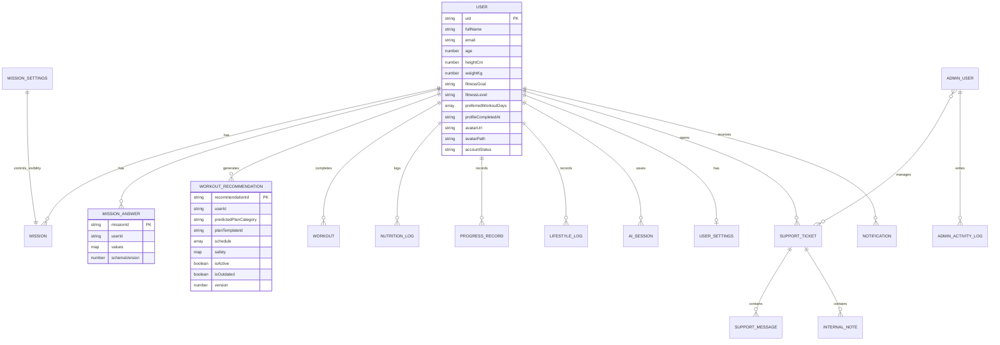

# Forge Athletic — Database Schema

---

## 1. Overview

The primary database is **Cloud Firestore**. There is no SQL database in the application runtime.

Top-level structure:

```text
users/{uid}
  missions/{missionId}
  mission_answers/{missionId}
  workout_recommendations/{recommendationId}
  workouts/{workoutRecordId}
  nutrition_logs/{YYYY-MM-DD}
  progress_records/{recordId}
  lifestyle_logs/{YYYY-MM-DD}
  ai_sessions/{sessionId}
  user_settings/preferences

adminUsers/{uid}
supportTickets/{ticketId}
  messages/{messageId}
  internal_notes/{noteId}
notifications/{notificationId}
adminActivityLogs/{logId}
workoutPlans/{docId}
exerciseLibrary/{docId}
nutritionPlans/{docId}
missionSettings/{missionId}
platformSettings/main
```

`users/{uid}/workout_sessions` appears only in `deleteAllActivity()` cleanup; no current write/read path for it was found. Treat it as a legacy/defensive collection name.

---

## 2. Relationship diagram



---

## 3. Member collections

### 3.1 `users/{uid}`

**Purpose:** canonical member profile and account state.

**Document ID:** Firebase Auth UID.

**Created by:** `ensureUserAccount()` on first authenticated hydration; can also be merged by `saveUserProfile()`.

**Important fields:**

| Field | Type | Notes |
|---|---|---|
| `uid` | string | Same as doc ID |
| `fullName` | string \| null | Display name |
| `email` | string \| null | Auth email |
| `photoURL` | string \| null | Provider photo |
| `avatarUrl` | string \| null | Supabase public URL |
| `avatarPath` | string \| null | Supabase object path |
| `avatarCleared` | boolean | Prevents fallback to provider photo after removal |
| `accountStatus` | `'active' \| 'suspended'` | Defaults absent → active |
| `age` | number | From Quick Start |
| `heightCm` | number | From Quick Start |
| `weightKg` | number | From Quick Start |
| `fitnessGoal` | string | Internal goal enum |
| `fitnessLevel` | string | Internal experience enum |
| `preferredWorkoutDays` | number[] | 0=Sunday…6=Saturday |
| `profileCompletedAt` | ISO string | Required for `normaliseProfile` |
| `createdAt`, `updatedAt` | Timestamp | Server timestamps |
| `schemaVersion` | number | Currently 1 |

**Read/write locations:**

- `getUserRecord`, `ensureUserAccount`, `saveUserProfile`, `updateUserAvatar` in `firestoreRepository.ts`.
- `listAllUsers`, `getAdminUserDetail`, `updateUserAccount` in `adminRepository.ts`.
- Security-sensitive fields `accountStatus`, `adminNote` are excluded from owner updates by rules.

### 3.2 `users/{uid}/missions/{missionId}`

**Purpose:** per-mission status/progress.

**Document ID:** mission ID (`body-metrics`, `health-profile`, `training-history`, `nutrition-profile`, `lifestyle-check`, `goal-deep-dive`, `mindset-mission`).

**Fields:**

| Field | Type |
|---|---|
| `missionId` | string |
| `userId` | string |
| `status` | `locked \| available \| in_progress \| completed` |
| `startedAt` | ISO string \| absent |
| `completedAt` | ISO string \| absent |
| `answeredFields` | number \| absent |
| `totalFields` | number \| absent |
| `updatedAt` | Timestamp |

**Writes:** `saveMissionProgress()` from profile store actions `startMission`, `completeMission`, `setMissionFieldProgress`, `resetMission`.

**Reads:** `getMissionProgress()` during profile hydration.

### 3.3 `users/{uid}/mission_answers/{missionId}`

**Purpose:** persisted mission form values, used by readiness checks and recommendation input.

**Document ID:** mission ID.

**Fields:**

```text
missionId: string
userId: string
values: map<string, string | number | boolean | string[]>
updatedAt: Timestamp
schemaVersion: 1
```

**Writes:** `persistMissionAnswers()` via `useProfileStore.saveMissionAnswers()`.

**Reads:** `fetchMissionAnswers()` during profile hydration.

**Sensitive-data note:** Although `MissionDefinition.sensitive` exists, the current code persists **all** mission values, including health free text, medication/allergy text, and medical clearance. Local storage also keeps a copy. This is a material privacy issue documented in technical debt.

### 3.4 `users/{uid}/workout_recommendations/{recommendationId}`

**Purpose:** generated AI plans and version history.

**Document ID:** `recommendationId` generated by `createId('rec')`.

**Fields:** the full `RecommendationDocument` from `src/features/workout-recommendation/types.ts`.

| Field | Type | Notes |
|---|---|---|
| `recommendationId` | string | Doc ID |
| `userId` | string | Owner |
| `modelVersion` | string | `1.0.0` |
| `modelSource` | `'onnx-web'` | Browser inference |
| `predictedPlanCategory` | string | One of 24 labels |
| `planTemplateId` | string | Internal template ID |
| `planTitle` | string | Display title |
| `fitnessGoal` | string | User goal enum |
| `datasetGoal` | string | Mapped dataset goal |
| `missionSnapshot.answers` | map | Authoritative subset of answers |
| `missionSnapshot.profile` | map | Age/height/weight/goal/experience/days |
| `missionSnapshot.capturedAt` | ISO string | Capture time |
| `missionSnapshot.schemaVersion` | number | Snapshot schema |
| `schedule` | array of `GeneratedDay` | Seven days |
| `safety` | map | Restricted/exclusions/notes/professional review/volume cap |
| `createdAt`, `updatedAt` | ISO string | Plan timestamps |
| `isActive` | boolean | One active plan expected |
| `isOutdated` | boolean | Recomputed from answers |
| `version` | number | Increments on regeneration |
| `generationStatus` | `'ready' \| 'superseded'` | Current code writes `ready` |
| `inferenceMs` | number | Measured browser inference |
| `confidence` | number | Max class probability |
| `classProbabilities` | array | Sorted label/probability list |

**Writes:**

- `persistRecommendation`, `deactivateRecommendations`, `markRecommendationsOutdated` in `recommendationRepository.ts`.
- `useRecommendationStore.generate` and `syncOutdated`.

**Reads:** `fetchRecommendations` during recommendation hydration.

**Security:** rules currently allow the owner to create/update their own plan. The source rules comment explicitly marks this as temporary until a backend inference API exists.

### 3.5 `users/{uid}/workouts/{recordId}`

**Purpose:** completed workout summaries.

**Document ID:** generated `workout_*` ID from `createId`.

**Fields:**

| Field | Type |
|---|---|
| `id` | string |
| `workoutId` | string — sample ID or `ai:{recommendationId}:{weekday}` |
| `title` | string |
| `focus` | string |
| `completedAt` | ISO string |
| `durationSeconds` | number |
| `exercisesCompleted` | number |
| `totalExercises` | number |
| `source` | `'plan' \| 'ai'` |
| `userId` | string |
| `updatedAt` | Timestamp |

**Read/write:** `getWorkouts`, `saveWorkout`, `deleteWorkout`; activity store `addWorkout`.

### 3.6 `users/{uid}/nutrition_logs/{date}`

**Document ID:** local date `YYYY-MM-DD`.

**Fields:**

```text
date: string
userId: string
meals: MealEntry[]
waterIntake: number
totals: { calories, protein, carbs, fat }
updatedAt: Timestamp
```

`MealEntry` contains `id`, `date`, `time`, `name`, `calories`, `protein`, `carbs`, `fat`.

**Read/write:** `getNutritionLogs`, `saveNutritionDay`; activity store meal/water actions.

### 3.7 `users/{uid}/progress_records/{recordId}`

**Document ID:** generated `measurement_*` ID.

**Fields:** `id`, `measuredAt`, `weightKg`, optional `bodyFat`, `waistCm`, `chestCm`, `restingHr`, `userId`, `recordDate` (`measuredAt.slice(0,10)`), `updatedAt`.

**Read/write:** `getMeasurements`, `saveMeasurement`, `deleteMeasurement`; Progress page.

### 3.8 `users/{uid}/lifestyle_logs/{date}`

**Document ID:** date `YYYY-MM-DD`.

**Fields:** `id`, `date`, `sleepHours`, `sleepQuality`, `steps`, `stress`, `recoveryHabits[]`, `userId`, `habits[]`, `updatedAt`.

**Read/write:** `getLifestyle`, `saveLifestyle`, `saveHabits`; Lifestyle page.

### 3.9 `users/{uid}/ai_sessions/{sessionId}`

**Document ID:** generated `ai-session_*` ID.

**Fields:** `id`, `exercise` (`squat|bicep_curl|push_up`), `exerciseLabel`, `completedAt`, `durationSeconds`, `reps`, `scores[]`, `averageFormScore`, `bestFormScore`, `verdict`, `source` (`camera|video`), `userId`, `updatedAt`.

Each score in `scores[]` is an `AISessionScore`:

```text
atSeconds, pGood, threshold, verdict,
rangeOfMotion, tempoVariation, torsoLean, kneeAsymmetry
```

**Read/write:** `getAISessions`, `saveAISession`; AI Coach save; Progress and admin monitoring.

### 3.10 `users/{uid}/user_settings/preferences`

Document ID: `preferences`.

**Fields:** `userId`, `preferences` (full `UserPreferences`), `updatedAt`.

`UserPreferences`:

```text
notifications: { workoutReminders, missionNudges, weeklyReview }
privacy: { productUpdates, localAnalytics }
reminderTime: string
weightUnit: 'kg'
distanceUnit: 'km'
```

**Read/write:** `getPreferences`, `savePreferences`; Settings page.

---

## 4. Admin and support collections

### 4.1 `adminUsers/{uid}`

**Document ID:** Firebase UID.

**Fields:** `uid`, `email`, `name`, `role`, `permissions[]`, `active`, `createdAt`, `updatedAt`, `lastLoginAt`.

**Roles:** `super_admin`, `admin`, `fitness_manager`, `support_manager`, `analyst`.

**Access:**

- Owner can read own record.
- Any admin can list/read admin records.
- Only `manage_roles` (Super Admin) can create/delete and change roles.
- Owner may update only `name`, `lastLoginAt`, `updatedAt`.

### 4.2 `supportTickets/{ticketId}`

**Document ID:** auto Firestore ID. Human-readable `ticketId` is `FRG-` + last six chars of the Firestore ID.

**Fields:** `ticketId`, `userId`, `userName`, `userEmail`, `subject`, `category`, `description`, `priority`, `status`, `assignedAdminId`, `assignedAdminName`, `messageCount`, `createdAt`, `updatedAt`, `lastMessageAt`, `resolvedAt`, `schemaVersion`.

**Enums:**

- Category: `account`, `workouts`, `ai-coach`, `nutrition`, `progress`, `technical`, `other`
- Priority: `low`, `medium`, `high`, `urgent`
- Status: `open`, `in_progress`, `waiting_for_user`, `resolved`, `closed`

**Access:**

- Owner can get/list own tickets.
- Support roles can get/list all and update status/priority/assignment.
- Create requires owner `userId`, status `open`, priority `medium`, valid category, subject 4–140 chars, description 10–5000 chars.
- Owner update is limited to `status`, `lastMessageAt`, `updatedAt`, `messageCount`, and only reopening from `resolved`/`waiting_for_user`.

### 4.3 `supportTickets/{ticketId}/messages/{messageId}`

**Fields:** `ticketId`, `senderId`, `senderName`, `senderRole` (`user|admin`), `message`, `createdAt`, `schemaVersion`.

**Access:**

- Owner or support can read.
- User create requires senderRole `user`, senderId own UID, ticket owner, ticket not closed.
- Admin create requires support permission, senderRole `admin`, senderId own UID.
- Update/delete denied.

### 4.4 `supportTickets/{ticketId}/internal_notes/{noteId}`

**Fields:** `ticketId`, `adminId`, `adminName`, `note`, `createdAt`, `schemaVersion`.

**Access:** support only; create requires `adminId == auth.uid`; update/delete only `manage_roles`.

### 4.5 `notifications/{notificationId}`

**Fields:** `userId`, `title`, `message`, `type` (`support|system|workout|mission`), `relatedTicketId`, `read`, `createdAt`, `schemaVersion`.

**Access:** owner can get/list and update only `read`; admin can read/create/update/delete.

**Created by:** admin reply (`addTicketMessage` with senderRole admin), and admin broadcast (`broadcastNotification`).

**Read by:** `DashboardTopbar` (latest 50 for member); admin notifications page (latest 100).

### 4.6 `adminActivityLogs/{logId}`

**Fields:** `adminId`, `adminName`, `action`, `targetType`, `targetId`, `detail`, `createdAt`.

**Access:** admin read; create only by admin with own `adminId`; immutable.

---

## 5. Global content and configuration collections

| Collection | Document ID | Fields used by UI | Consumer |
|---|---|---|---|
| `workoutPlans` | auto | `title`, `focus`, `difficulty`, `durationMinutes`, `daysPerWeek`, `description`, `exercises`, `status`, `createdAt`, `updatedAt` | Admin EntityManager only |
| `exerciseLibrary` | auto | `name`, `muscleGroups`, `difficulty`, `aiSupported`, `repCounting`, `instructions`, `createdAt`, `updatedAt` | Admin EntityManager only |
| `nutritionPlans` | auto | `name`, `goal`, `status`, `calories`, `protein`, `carbs`, `fat`, `notes`, `createdAt`, `updatedAt` | Admin EntityManager only |
| `missionSettings` | mission ID | `enabled`, `updatedAt` | Member Missions page, Admin Missions page |
| `platformSettings` | `main` | `supportEmail`, `supportSlaHours`, `maintenanceMessage`, `updatedAt` | Admin Settings page only |

**Important:** the member Workout Plans, AI plan generator, Exercise Library, and Nutrition pages use static TypeScript catalogs (`src/data/*`, `src/features/workout-recommendation/data/*`) rather than these Firestore content collections. Admin edits to those collections do not affect the member experience today.

---

## 6. Document ID and ordering conventions

| Area | ID strategy | Ordering |
|---|---|---|
| User | Auth UID | — |
| Mission progress | mission ID | — |
| Mission answers | mission ID | — |
| Recommendations | `createId('rec')` | `createdAt` descending |
| Workouts | `createId('workout')` | `completedAt` descending |
| Nutrition | local date | date |
| Measurements | `createId('measurement')` | `measuredAt` descending |
| Lifestyle | local date | date descending |
| AI sessions | `createId('ai-session')` | `completedAt` descending |
| Tickets | auto ID + `FRG-XXXXXX` | `lastMessageAt` descending in memory |
| Notifications | auto ID | `createdAt` descending |
| Admin users | Firebase UID | name in memory |
| Content | auto ID or supplied ID | `createdAt` descending in memory |

### Timestamp inconsistency

- User/activity/support docs use Firestore `serverTimestamp()` and are normalized through `iso()` when read.
- Recommendation docs store `createdAt`/`updatedAt` as ISO strings.
- `profileCompletedAt` is an ISO string.
- Content rows returned by `listContent<T>()` are not normalized; the admin table handles Firestore `Timestamp` objects through `CellValue`.

There is no single timestamp convention across all collections. This is technical debt, though current readers tolerate both shapes on the paths they use.

---

## 7. Cloud/local mirror

Every member data domain has a localStorage mirror:

| Domain | localStorage key |
|---|---|
| Profile | `forge:v1:profile:{uid}` |
| Mission progress | `forge:v1:missions:{uid}` |
| Mission answers | `forge:v1:mission-answers:{uid}` |
| Recommendations | `forge:v1:recommendations:{uid}` |
| Activity snapshot | `forge:v1:activity:{uid}` |
| Demo session marker | `forge:demo-session:v1` |

Cloud writes are best-effort; local state remains authoritative if Firestore is unavailable. On the next successful hydration, cloud data wins unless cloud is empty, in which case local data is migrated.

There is no TTL, versioned migration for localStorage shapes, or conflict resolution beyond “cloud wins when non-empty.”

---

## 8. Supabase Storage relationship

Firestore stores only metadata:

```text
users/{uid}.avatarUrl  → public Supabase URL
users/{uid}.avatarPath → object path: {uid}/avatar-{timestamp}-{suffix}.{jpg|png|webp}
```

Bucket: `profile-images` (public read, owner-folder writes).
No other Supabase tables are used.

---

## 9. Security rule summary

- Owner-only access to user documents and all user subcollections.
- Admin reads across users and subcollections.
- Support/admin collections gated by role helpers.
- Global content writes gated by content/platform roles.
- Default deny at the end.
- Recommendation and mission-answer writes are currently owner-writable by design, pending a backend.

See `SECURITY_ARCHITECTURE.md` for the full analysis and gaps.
