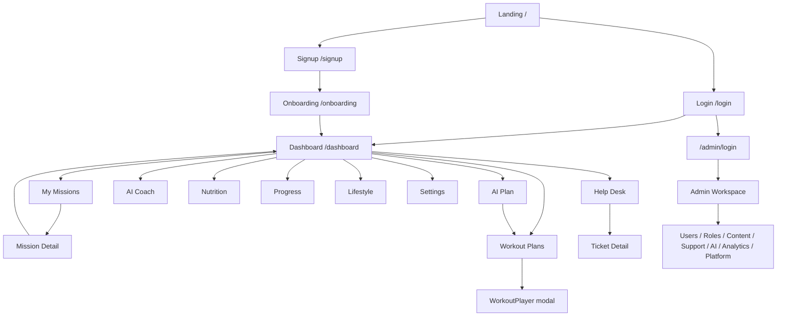

# Forge Athletic — Frontend Architecture

---

## 1. Application shell and initialization

```text
index.html
  └─ src/main.tsx
       ├─ React.StrictMode
       ├─ QueryClientProvider (staleTime 60s, retry 1)
       └─ src/App.tsx
            ├─ BrowserRouter
            ├─ AuthProvider
            ├─ ScrollToTop
            ├─ Suspense fallback FullScreenLoader
            ├─ Routes
            └─ Sonner Toaster
```

- **Framework:** React 18 function components.
- **Build:** Vite 6 with lazy route imports in `src/App.tsx`.
- **Styling:** Tailwind CSS with tokens in `tailwind.config.js`: charcoal `#171717`, orange `#F97316`, ivory `#F7F5F0`, Anton display, DM Sans body.
- **Animation:** Framer Motion in layouts, landing sections, and modal/dialog interactions.
- **Charts:** Recharts on Overview, Progress, Admin Overview, Admin Analytics, Support Analytics, AI monitoring.
- **Forms:** React Hook Form with Zod resolvers for auth and onboarding; mission forms also use React Hook Form with manual field rules.
- **Notifications:** Sonner toasts.
- **React Query:** Provider exists globally, but most feature pages use local `useState`/`useEffect` + repository functions rather than `useQuery`.

---

## 2. Route map

### Public routes

| Path | Component | Guard | Purpose |
|---|---|---|---|
| `/` | `pages/LandingPage/index.tsx` | none | Marketing site with 11 sections |
| `/login` | `pages/Login/index.tsx` | `PublicOnly` | Email/password + Google; demo entry via notice when Firebase unconfigured |
| `/signup` | `pages/Signup/index.tsx` | `PublicOnly` | Account creation, terms acceptance, password strength |
| `/forgot-password` | `pages/ForgotPassword/index.tsx` | `PublicOnly` | Firebase reset email |
| `/privacy` | `pages/Legal/PrivacyPage.tsx` | none | Privacy policy |
| `/terms` | `pages/Legal/TermsPage.tsx` | none | Terms |
| `/onboarding` | `pages/Onboarding/index.tsx` | `RequireAuth` | Four-step Quick Start |
| `*` | `pages/NotFound/index.tsx` | none | 404 |

`PublicOnly` redirects an authenticated user to `/dashboard`.

### Member dashboard routes

All are children of `RequireAuth` → `DashboardLayout`.

| Path | Component | Main data sources | Key interactions |
|---|---|---|---|
| `/dashboard` | `Dashboard/OverviewPage.tsx` | `useProfileStore`, `useActivityStore`, `useProfileStats`, `RecommendationSpotlight`, static `WORKOUTS`/`MOTIVATION` | Mission CTA, AI spotlight, weekly/monthly activity chart, streak, recent activity, achievements, planned sample workout |
| `/dashboard/missions` | `Dashboard/MissionsPage.tsx` | `MISSIONS`, `missionSettings` Firestore, profile store | Mission cards, progress ring, advanced assessments gate, achievements |
| `/dashboard/missions/:missionId` | `Dashboard/MissionDetailPage.tsx` | `MISSIONS`, profile store answers/progress | Dynamic form, save-for-later, complete, sensitive confirmation, XP |
| `/dashboard/workouts` | `Dashboard/WorkoutsPage.tsx` | active AI recommendation, activity store, static `WORKOUTS` | AI hero/week/upcoming/program blocks; sample plan path; `WorkoutPlayer`; save workout |
| `/dashboard/workout-recommendation` | `Dashboard/WorkoutRecommendationPage.tsx` | `useWorkoutRecommendation`, recommendation store, ONNX inference | Locked checklist, generate/regenerate, plan schedule, safety, model metadata, history |
| `/dashboard/nutrition` | `Dashboard/NutritionPage.tsx` | activity store meals/water, static targets/sample meals | Log meal modal, delete meal, water counter, macro chart, 7-day calories |
| `/dashboard/progress` | `Dashboard/ProgressPage.tsx` | activity store measurements/workouts/AI sessions, profile stats | Log measurement, metric trends, history, workout frequency, AI sessions |
| `/dashboard/lifestyle` | `Dashboard/LifestylePage.tsx` | activity store lifestyle/habits | Recovery check-in, sleep chart, habit checklist |
| `/dashboard/ai-coach` | `Dashboard/AICoachPage.tsx` | `useActivityStore.addAISession`, MediaPipe/ONNX | Camera or video, exercise selection, live pose, reps, form score, cues, save session |
| `/dashboard/settings` | `Dashboard/SettingsPage.tsx` | auth, profile/activity/recommendation stores, storage health | Profile photo, preferences, help/legal links, reset local data, clear activity, sign out |
| `/dashboard/help-desk` | `Dashboard/HelpDesk/HelpDeskPage.tsx` | `getUserTickets`, `createTicket` | Ticket list/filter, new-ticket modal |
| `/dashboard/help-desk/:ticketId` | `Dashboard/HelpDesk/HelpDeskTicketPage.tsx` | `getTicket`, `getTicketMessages`, `addTicketMessage`, `reopenTicket` | Conversation, reply, reopen |
| `/dashboard/*` | redirect to `/dashboard` | — | Catch-all inside dashboard |

### Admin routes

All are under `AdminAccessProvider` and `RequireAdmin`, except `/admin/login`, which uses `AdminAccessProvider` only.

| Path | Component | Permission gate |
|---|---|---|
| `/admin/login` | `Admin/AdminLoginPage.tsx` | admin access provider |
| `/admin` | redirect `/admin/overview` | `RequireAdmin` |
| `/admin/overview` | `Admin/OverviewPage.tsx` | authenticated admin |
| `/admin/users` | `Admin/UserManagementPage.tsx` | `manage_users` |
| `/admin/roles` | `Admin/RolesPage.tsx` | `manage_roles` |
| `/admin/workouts` | `Admin/WorkoutsPage.tsx` | `manage_content` |
| `/admin/exercises` | `Admin/ExercisesPage.tsx` | `manage_content` |
| `/admin/missions` | `Admin/MissionsPage.tsx` | `manage_content` |
| `/admin/nutrition` | `Admin/NutritionPage.tsx` | `manage_content` |
| `/admin/help-desk` | `Admin/HelpDeskPage.tsx` | `manage_support` |
| `/admin/help-desk/:ticketId` | `Admin/HelpDeskTicketPage.tsx` | `manage_support` |
| `/admin/support-analytics` | `Admin/SupportAnalyticsPage.tsx` | `manage_support` |
| `/admin/ai-monitoring` | `Admin/AIMonitoringPage.tsx` | `manage_ai` |
| `/admin/ai-coach-monitoring` | `Admin/AICoachMonitoringPage.tsx` | `manage_ai` |
| `/admin/analytics` | `Admin/AnalyticsPage.tsx` | `view_analytics` |
| `/admin/media` | `Admin/MediaPage.tsx` | `manage_platform` |
| `/admin/notifications` | `Admin/NotificationsPage.tsx` | `manage_platform` |
| `/admin/settings` | `Admin/SettingsPage.tsx` | `manage_platform` |
| `/admin/profile` | `Admin/ProfilePage.tsx` | authenticated admin |
| `/admin/*` | redirect `/admin/overview` | — |

Note: `manage_ai` is granted to both `super_admin` and `admin` in `ROLE_PERMISSIONS`, so both roles can open AI monitoring. The `manage_platform` routes (media, notifications, settings) are Super Admin-only because `ROLE_PERMISSIONS.admin` omits `manage_platform`.

---

## 3. Layouts and navigation

### `DashboardLayout`

- Left fixed `DashboardSidebar` at `lg` and above; slide-over drawer below.
- `DashboardTopbar` includes notifications and the member menu.
- Cloud/local banner when Firestore sync fails.
- Blocks suspended accounts based on `useProfileStore.accountStatus`.
- Redirects authenticated users without a profile to `/onboarding`.
- `MobileBottomNav` is a six-tab fixed bottom bar: Overview, Missions, AI Plan, AI Coach, Workouts, Progress.

### Dashboard sidebar navigation

From `src/components/navigation/dashboardNav.ts`:

1. Overview → `/dashboard`
2. My Missions → `/dashboard/missions`
3. Workout Plans → `/dashboard/workouts`
4. AI Plan → `/dashboard/workout-recommendation` (badge “New”)
5. Nutrition
6. Progress
7. Lifestyle
8. AI Coach (badge “Live”)
9. Help Desk
10. Settings

### `AdminLayout`

- Same responsive sidebar/drawer pattern with `AdminSidebar` and `AdminTopbar`.
- Admin navigation groups: Overview; User management; Fitness management; Support; AI management; Platform; Account.
- Footer explicitly states role-based access is enforced by Firestore rules.

### Public navigation

`PublicNavbar` links to landing anchors (`/#programs`, `/#how-it-works`, `/#about`, `/#contact`) plus login/signup. `PublicFooter` contains legal and placeholder social links.

---

## 4. Authentication and route guards

### `AuthProvider` (`src/features/auth/AuthContext.tsx`)

State:

- `user: AppUser | null`
- `loading`
- `configured: boolean`
- `missingVariables: string[]`

Actions:

- `signIn`, `signUp`, `signInWithGoogle`, `sendPasswordReset`, `signOut`, `enterDemo`.

On auth change:

1. Sets user/loading.
2. Hydrates `useProfileStore` with `{ cloud: !isDemo, email, displayName, photoURL }`.
3. Hydrates `useActivityStore` with `{ cloud: !isDemo }`.
4. On sign-out clears both stores.

Demo mode:

- `startDemoSession()` writes `forge:demo-session:v1` to localStorage and returns UID `demo-athlete`.
- In development, `authService.subscribe` resumes the demo even when Firebase is configured.
- Demo accounts are rejected by `useAdminAccess`.

### Guards

| Guard | Behavior |
|---|---|
| `RequireAuth` | Loading → full-screen loader; no user → `/login` with return location |
| `PublicOnly` | Authenticated → `/dashboard` |
| `RequireOnboarding` | Defined but not used by the route tree; onboarding redirect is handled in `DashboardLayout` |
| `RequireAdmin` | Loading → loader; no user → `/admin/login`; non-admin → access-denied screen |
| `RequireAdminPermission` | Client-side permission gate; renders restricted-area panel if missing |

The guards are convenience gates. The actual data boundary is Firestore rules (see `SECURITY_ARCHITECTURE.md`).

---

## 5. State management

### `useProfileStore` (`src/store/useProfileStore.ts`)

Owns:

- `profile: QuickStartProfile | null`
- `progress: Record<string, MissionProgress>`
- `answers: MissionAnswerMap`
- `avatarUrl`, `avatarPath`, `accountStatus`
- `hydrated`, `cloudEnabled`, `syncStatus`, `syncError`, `lastSyncedAt`

Persistence behavior:

- Always writes Quick Start profile, mission progress, and answers to localStorage repositories.
- When `cloudEnabled`, writes user profile, mission progress, answers, and avatar metadata to Firestore.
- `hydrate`:
  1. Loads localStorage profile/progress/answers.
  2. If cloud enabled: `ensureUserAccount`, read user record/missions/mission answers.
  3. Cloud values win once present.
  4. One-time migration of local profile/progress when cloud is empty.
  5. Uses a write queue and 8-second timeout wrapper.
- `resetAllData()` clears only local profile/answers/recommendation cache; it does not delete Firestore records.

### `useActivityStore` (`src/store/useActivityStore.ts`)

Owns all activity domains from `ActivityState`:

- workouts, meals, water, measurements, lifestyle, habits, AI sessions, preferences.

Behavior:

- Every mutation writes the full local `ActivityState` snapshot to localStorage.
- Cloud mutations call the specific Firestore repository function.
- `hydrate` reads local first, then Firestore. If cloud is empty and local has data, it writes a migration snapshot.
- `clearActivity()` deletes all activity collections for the user (cloud) and clears local data.
- Sync status/error and last synced time are tracked.

### `useRecommendationStore` (`src/store/useRecommendationStore.ts`)

Owns:

- `plans: RecommendationDocument[]`
- `hydrated`, `loading`, `generating`, `error`, `errorCode`

Behavior:

- Hydrates local plans; merges Firestore plans by `recommendationId`.
- Refreshes `isOutdated` flags against current mission answers.
- `generate()`:
  1. Calls `createRecommendation` (readiness, model input, ONNX, generator).
  2. Marks existing plans inactive.
  3. If cloud enabled: deactivates old plans and persists the new one.
  4. Always persists to localStorage.
- `syncOutdated()` updates active plan flags when answers change.
- `selectActivePlan()` returns the active plan or the newest plan.

### Some local component state

Pages also use local `useState` for dialogs, filters, selected history version, form values, and generation errors. These are not global stores.

---

## 6. Data fetching patterns

There is no centralized API client. Pages call repositories directly:

- Member profile/activity: `src/services/cloud/firestoreRepository.ts`
- Mission answers/recommendations: `src/features/workout-recommendation/data/recommendationRepository.ts`
- Admin/support/content: `src/services/cloud/adminRepository.ts`
- Auth: `src/services/authService.ts`
- Storage: `src/services/cloud/storageService.ts`
- AI models: `fetch` + dynamic imports in feature libraries.

Pattern:

```text
Page/Component
  → Zustand store action or repository function
    → Firebase client SDK / localStorage
      → store state update
        → React re-render
```

Admin pages use local `useState` + `useEffect` and explicit `load()` functions. There is no shared admin query cache, so switching pages refetches.

---

## 7. Member page details

### Overview

- Real: mission progress, XP, activity series, streak, recent mission/workout/AI events, completion stats.
- Sample: planned workout card is selected from static `WORKOUTS` (`src/data/dashboard.ts`) based on the current weekday/profile days; motivation quote is static.
- AI spotlight uses the active recommendation and links to the AI Plan page.

### Missions

- Mission definitions are code-defined in `src/data/missions.ts`; Firestore `missionSettings` only controls visibility.
- All missions begin `available`; there is no enforced sequential unlocking.
- Progress ring/completion/XP use `useProfileStats`.
- Advanced assessments and achievements are displayed; advanced assessments are gated behind all seven missions in the UI.

### Mission Detail

- Dynamic renderer handles `text`, `number`, `textarea`, `select`, `multiselect`, `scale`, `toggle`.
- `Save for later` persists answers and marks the mission `in_progress`.
- `Complete mission` persists answers, marks `completed`, and computes completion.
- Sensitive missions (`health-profile`, `nutrition-profile`) show a confirmation dialog before completion.
- Current code persists all normalized form values, including health free text, to `users/{uid}/mission_answers/{missionId}` and localStorage.
- Body Metrics includes an optional `gender` select (female/male/unspecified) used by the recommendation model.
- The progress-photo picker is a local object-URL preview only.

### Workout Plans

- Calls `useWorkoutRecommendation`.
- If an active AI plan exists, renders the AI-specific experience from `AiWorkoutSections.tsx`:
  - `AiPlanHero`: real category, split, duration, week label, schedule pills, stats, image, start/preview/full-plan actions.
  - `AiWeekGlance`: seven-day plan with completed markers.
  - `AiUpcomingSessions`: remaining training days.
  - `AiProgramBlocks`: current/previous plan versions.
- Start uses `toWorkoutSession(plan, day)` and opens `WorkoutPlayer`.
- Saving produces a completed workout with `workoutId = ai:{recommendationId}:{weekday}` and `source: 'plan'`.
- Completion is derived from workouts in the current week; adherence = completed AI weekdays / scheduled AI training days.
- If no active AI plan, page renders the sample experience: `RecommendationSpotlight`, static `WORKOUTS`, static plan library (Foundation Strength / Hybrid Engine / Rebuild & Recover), sample weekly grid, and sample history CTA.

### AI Plan

- `useWorkoutRecommendation` computes readiness using **persisted answers**, not just mission completion badges.
- Locked state shows completed mission count, remaining missions, readiness warnings.
- Generate runs real ONNX inference, then generates and validates the plan.
- Plan view includes schedule, safety notes, model metadata (version, category, confidence, inference ms), version history, and outdated-plan warning.
- Regeneration marks the previous plan inactive and increments version.
- Preloads the ONNX model after first paint through `preloadWorkoutModel()`.

### Nutrition

- Real meal entries (`MealEntry`), water by date, and removal.
- Targets (`NUTRITION_TARGETS`) are static: 2400 kcal, 168 g protein, 260 g carbs, 72 g fat, 3.0 L water.
- Example day (`DAILY_MEALS`) is explicitly sample content.
- Daily macro totals and a seven-day calorie chart are computed from logged meals.
- No personalized macro calculation from body metrics/goal exists.

### Progress

- Real `MeasurementRecord`, completed workouts, and AI sessions.
- Metric trend for weight/body fat/waist/chest/resting HR (depending on available data).
- Measurement dialog validates numbers, stores to activity store (and Firestore if cloud).
- Workout frequency and AI form-session history use real records.
- Deletion supported for measurements.

### Lifestyle

- Real daily `LifestyleEntry`: sleep hours/quality, steps, stress, recovery habits.
- Habit checklist stored by date.
- Seven-day sleep chart from logged entries.
- No wearable or device integration.

### AI Coach

See `AI_ML_ARCHITECTURE.md` for the model pipeline. Frontend specifics:

- Exercise selector for squat, bicep curl, push-up.
- Camera via `navigator.mediaDevices.getUserMedia`, or uploaded video with object URL.
- 33-landmark MediaPipe overlay on canvas.
- Reps counted independently from model score.
- Form score sampled every ~1.8 s from the last 180 frames.
- Session save requires at least one model score; stores summary and score windows.
- Raw frames are not persisted or uploaded.

### Settings

- Profile photo upload/delete through Supabase.
- Preferences (notifications toggles, privacy toggles, reminder time, units) persisted.
- Password reset via Firebase.
- Sign out.
- Reset local profile cache (does not delete Firestore).
- Clear activity (deletes Firestore activity collections).
- Displays storage/Firebase configuration status.
- **Contains stale privacy copy** claiming medical/mission answers are never persisted; actual code persists them. See technical debt.

### Help Desk

- User sees only their tickets (`where('userId','==',uid)` plus rule enforcement).
- New ticket: subject, category, priority fixed to `medium`; description validation (4/10 character minimums).
- Ticket detail: original description + messages, reply, reopen when resolved.
- No attachments; no realtime listener (explicit reload after send).

---

## 8. Admin page details

### Access and login

- Admin login uses the same Firebase Auth session as members.
- `useAdminAccess` reads `adminUsers/{uid}`; requires record existence and `active === true`.
- Demo accounts are denied.
- Admin and member sessions share sign-out.

### Overview (`Admin/OverviewPage.tsx`)

- `useAdminSnapshot` loads users, collection-group workouts/missions/AI sessions, tickets/messages, and nutrition-log count.
- Displays registration trend, training/AI activity, support breakdown, AI exercise mix, recent activity, infrastructure status (Supabase health, AI metadata check).
- Uses safe fallbacks per query and reports partial errors.

### User management

- Lists all Firestore user docs with search, status, registration-period filters, pagination.
- Detail panel loads workouts, measurements, missions, nutrition count, AI session count, ticket count.
- Edit display name; suspend/reactivate; writes `adminActivityLogs`.
- Suspension is surfaced to the member dashboard, but Firestore rules do not block suspended users from their data.

### Roles

- Lists `adminUsers`; provision an existing member; change role; activate/deactivate.
- Self-demotion/self-deactivation prevented in UI.
- Role writes are protected by `canManageRoles` rules.

### Content managers

- `WorkoutsPage`, `ExercisesPage`, `NutritionPage` use `EntityManager` against `workoutPlans`, `exerciseLibrary`, `nutritionPlans`.
- CRUD is real Firestore CRUD, but these collections are **not consumed** by member workout/nutrition/exercise generator pages.
- Exercises page correctly notes only squat, bicep curl, push-up are AI-supported.

### Missions

- Lists code-defined missions and toggles `missionSettings/{missionId}.enabled`.
- Member Missions page filters out disabled missions.
- Does not edit mission fields or definitions.

### Help Desk

- Queue with search/status/priority/category/assignment filters.
- Ticket page: conversation, admin reply (sets `waiting_for_user`, assigns if unassigned), status/priority changes, assignment, internal notes, member context, first-response metric.
- Admin reply creates a `notifications` document for the member.

### Analytics

- Builds aggregate charts from `useAdminSnapshot`.
- CSV export of visible member profile fields from loaded users.
- No server-generated report file or scheduled report.

### AI monitoring

- `AIMonitoringPage`: form-model metadata/HEAD availability, saved AI sessions, exercise mix, verdict distribution, recent sessions. Inference latency shown as unavailable because it is not collected.
- `AICoachMonitoringPage`: usage/outcomes, reps, members, average form score, per-exercise breakdown, recent sessions.
- No monitoring for `workout_recommendation.onnx`, recommendation confidence distribution, or plan-generation failures.

### Media

- Reads all users and shows avatar records/URLs, storage health, missing-photo state.
- No upload/replace/delete from the admin page.

### Notifications

- Reads latest 100 `notifications` records.
- Broadcast form writes one notification per user in batches of 400.
- No email/push delivery.

### Platform settings

- Reads/writes `platformSettings/main`: support email, SLA hours, maintenance message.
- Maintenance message is stored but not injected into member UI.

### Admin profile

- Edits admin display name and updates `lastLoginAt`; displays role permissions; sign-out.

---

## 9. Navigation and page relationship



---

## 10. Frontend technical boundaries

- No server-side rendering.
- No service worker / PWA manifest.
- No realtime Firestore listeners in member/admin pages; pages reload on actions or mount.
- No global error boundary; page-level error states are used in admin pages, while member pages use toasts and inline errors.
- No frontend test suite for UI components; only recommendation-domain tests exist.
- `React Query` is configured but underused.
