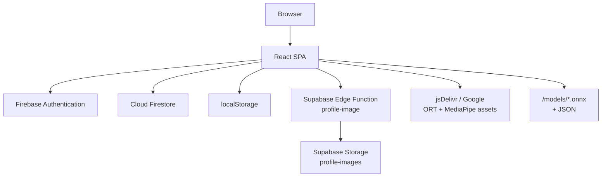
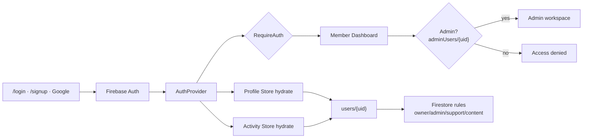

# Forge Athletic — Master Project Map

**This is the primary entry point for understanding the repository.**  
Project root: `F:\Fitness Coach`  
Audit date: 2026-11-22.

---

## 1. One-paragraph summary

Forge Athletic is a React 18 + Vite 6 + TypeScript single-page application with a public marketing site, Firebase Authentication, a member dashboard, an administrator workspace, and two browser-local AI systems. Structured data lives in Cloud Firestore; profile images live in Supabase Storage behind a Supabase Edge Function that verifies Firebase ID tokens. The application has **no application backend server and no member API**. Workout recommendation inference, plan generation, plan safety validation, and exercise-form inference all run in the browser using ONNX Runtime Web and MediaPipe. Firestore security rules and client route guards provide the current authorization model. The recommendation model is real and integrated; the form model is real and integrated but has modest held-out accuracy. Several admin content collections and some sample dashboard areas are not yet connected to the member experience.

---

## 2. Technology stack

| Layer | Actual implementation |
|---|---|
| UI | React 18.3, TypeScript 5.6 strict, Vite 6 |
| Routing | React Router 6.28 |
| Styling | Tailwind 3.4 with custom brand tokens |
| State | Zustand 5 |
| Forms | React Hook Form + Zod |
| Server state | TanStack React Query installed/configured, largely unused |
| Auth | Firebase Auth 11: email/password, Google popup, reset, demo |
| Database | Cloud Firestore client SDK |
| File storage | Supabase Storage `profile-images` + `profile-image` Edge Function |
| Browser AI | ONNX Runtime Web WASM + MediaPipe Tasks Vision |
| Charts | Recharts |
| Animation | Framer Motion |
| Tests | Vitest, two recommendation-domain test files |
| Hosting | Static SPA; `vercel.json` rewrites all routes to `index.html` |
| Firebase project | `forge-11cbf` |

---

## 3. Repository map

```text
F:\Fitness Coach
├── src/                         # React application
│   ├── App.tsx                  # route tree
│   ├── main.tsx                 # React root + providers
│   ├── components/              # UI, layout, admin/dashboard shells, player
│   ├── data/                    # missions + static landing/dashboard content
│   ├── features/
│   │   ├── auth/                # Firebase Auth provider
│   │   ├── admin/               # access, snapshot, model metadata hooks
│   │   ├── ai-coach/            # form model, pose features, rep counter
│   │   └── workout-recommendation/ # ONNX inference, generator, catalog, UI
│   ├── hooks/                   # cloud/storage status
│   ├── layouts/                 # dashboard/admin shells
│   ├── lib/                     # Firebase, Supabase, constants, utils
│   ├── pages/                   # public, dashboard, admin, legal
│   ├── schemas/                 # auth + onboarding Zod
│   ├── services/                # auth, local repos, Firestore, storage
│   ├── store/                   # profile, activity, recommendation stores
│   ├── types/                   # domain types
│   └── utils/                   # activity/mission calculations
├── public/
│   ├── images/                  # marketing images
│   ├── models/                  # ONNX + schema/metadata
│   ├── model-check.html         # standalone form-model check
│   └── model-check-fixture.json
├── ml/                          # exercise-form training/evaluation project (read-only)
├── workout-recommendation/      # recommendation training project + artifacts (read-only)
├── supabase/
│   ├── functions/profile-image/ # only server-side application code
│   └── storage-policies.sql
├── scripts/
│   ├── copy-model-assets.mjs
│   └── copy-ort-wasm.mjs        # legacy/unused
├── firestore.rules              # authorization source
├── firebase.json                # rules/index/emulator config
├── firestore.indexes.json       # empty
├── vercel.json                  # SPA rewrite
├── package.json
├── vite.config.ts
├── tailwind.config.js
└── docs/architecture/           # this documentation
```

Detailed tree: [DIRECTORY_STRUCTURE.md](./DIRECTORY_STRUCTURE.md).

---

## 4. Runtime architecture



- Auth state drives profile/activity hydration.
- Stores write localStorage immediately and Firestore asynchronously.
- Admin pages read Firestore directly.
- AI model files are static assets; inference is local.
- The only server-side application code is the profile-image Edge Function.

Detailed backend: [BACKEND_ARCHITECTURE.md](./BACKEND_ARCHITECTURE.md), [API_REFERENCE.md](./API_REFERENCE.md).

---

## 5. Frontend module map

| Module | Key files | Responsibility |
|---|---|---|
| App shell | `src/App.tsx`, `src/main.tsx` | Lazy routes, auth provider, suspense, toaster |
| Auth | `src/features/auth/AuthContext.tsx`, `src/services/authService.ts` | Firebase auth + demo session + error mapping |
| Route guards | `src/components/layout/RouteGuards.tsx`, `AdminRouteGuard.tsx` | Auth/admin/permission gates |
| Member shell | `src/layouts/DashboardLayout.tsx`, `DashboardSidebar.tsx`, `DashboardTopbar.tsx`, `MobileBottomNav.tsx` | Navigation, cloud banner, suspension block, notifications |
| Admin shell | `src/layouts/AdminLayout.tsx`, `AdminSidebar.tsx`, `AdminTopbar.tsx`, `navigation/adminNav.ts` | Admin navigation and layout |
| Profile store | `src/store/useProfileStore.ts` | Quick Start, missions, answers, avatar, account status |
| Activity store | `src/store/useActivityStore.ts` | Workouts, meals, water, measurements, lifestyle, AI sessions, preferences |
| Recommendation store | `src/store/useRecommendationStore.ts` | Plan hydration, generation, active/outdated history |
| Member pages | `src/pages/Dashboard/**` | Overview, missions, plans, AI plan, AI coach, nutrition, progress, lifestyle, settings, help desk |
| Admin pages | `src/pages/Admin/**` | Overview, users, roles, content, support, AI monitoring, analytics, media, notifications, settings, profile |
| UI primitives | `src/components/ui/**`, `components/dashboard/ui.tsx`, `components/admin/ui.tsx` | Buttons, cards, modals, badges, progress, empty/error/loading states |
| Workout player | `src/components/dashboard/WorkoutPlayer.tsx` | Set-by-set execution and summary persistence |

Detailed pages/routes/navigation: [FRONTEND_ARCHITECTURE.md](./FRONTEND_ARCHITECTURE.md).

---

## 6. Authentication and authorization map



- Member UID is the Firestore owner key.
- Admin identity is a Firestore record attached to the same Firebase user.
- Roles: super_admin, admin, fitness_manager, support_manager, analyst.
- Rules enforce owner/subcollection access; route guards are UX.
- Demo UID is `demo-athlete` and has no Firestore admin access.

Detailed model: [SECURITY_ARCHITECTURE.md](./SECURITY_ARCHITECTURE.md).

---

## 7. Data model map

```text
users/{uid}
  ├─ missions/{missionId}
  ├─ mission_answers/{missionId}
  ├─ workout_recommendations/{recommendationId}
  ├─ workouts/{recordId}
  ├─ nutrition_logs/{YYYY-MM-DD}
  ├─ progress_records/{recordId}
  ├─ lifestyle_logs/{YYYY-MM-DD}
  ├─ ai_sessions/{sessionId}
  └─ user_settings/preferences

adminUsers/{uid}
supportTickets/{ticketId}
  ├─ messages/{messageId}
  └─ internal_notes/{noteId}
notifications/{notificationId}
adminActivityLogs/{logId}
workoutPlans/{id}
exerciseLibrary/{id}
nutritionPlans/{id}
missionSettings/{missionId}
platformSettings/main
```

Ownership:

- User subcollections are owner-scoped by UID.
- Support tickets are owner-scoped by `userId` and support-role readable.
- Notifications are owner-scoped by `userId`.
- Admin collections are role-gated.
- Content catalogs are global and currently consumed by admin only (except `missionSettings`).

Full fields and relationships: [DATABASE_SCHEMA.md](./DATABASE_SCHEMA.md).

---

## 8. AI/ML map

### 8.1 Exercise-form detection

```text
Camera/video
  → MediaPipe Pose Landmarker (33 landmarks, ~10 Hz)
  → required-joint visibility gate
  → 60-feature clip (angles, torso, sway, symmetry, rep metrics)
  → per-exercise ONNX Random Forest
  → p(GOOD) vs threshold (0.66/0.64/0.58)
  → GOOD / needs-work + measured cues
  → independent angle-state rep counter
  → user saves session summary to Firestore/localStorage
```

Artifacts: three ONNX files in `public/models/`; metadata in `model_metadata.json`; training code/reports in `ml/`.

### 8.2 Workout recommendation

```text
7 missions complete + persisted answers
  → readiness validation
  → map/clamp model input (BMI derived, injury category derived)
  → SmartFit ONNX classifier (24 plan categories)
  → template + static exercise library + safety filters
  → volume/session/day generation
  → structural/safety validation
  → plan persisted with version/confidence
  → AI Plan page + Workout Plans page
  → WorkoutPlayer
  → completed workout → adherence/history
```

Artifacts: `workout-recommendation/artifacts/workout_recommendation.onnx`, copied to `public/models/`. Training: gradient boosting, opset 17, synthetic SmartFit dataset. Model version 1.0.0.

### 8.3 Status distinctions

| Capability | Status |
|---|---|
| Form pose detection + classification | IMPLEMENTED |
| Form rep counting | IMPLEMENTED (motion heuristic) |
| Recommendation category classifier | IMPLEMENTED |
| Seven-day plan generator + safety validation | IMPLEMENTED |
| Plan persistence/history | IMPLEMENTED |
| Server-side inference | PLANNED / absent |
| Adaptive load/volume progression | ABSENT |
| Recommendation monitoring in admin | ABSENT |
| Admin exercise library feeding generator | NOT CONNECTED |

Full detail: [AI_ML_ARCHITECTURE.md](./AI_ML_ARCHITECTURE.md).

---

## 9. End-to-end workflows

| Workflow | Entry | Main outcome |
|---|---|---|
| Registration/login | `/signup`, `/login`, Google | Firebase user + local/cloud hydration |
| Onboarding | `/onboarding` | Quick Start profile + initial mission progress |
| Missions | `/dashboard/missions` | Persisted answers, completion, XP |
| AI plan | `/dashboard/workout-recommendation` | Real ONNX category + generated validated plan |
| Workout execution | `/dashboard/workouts` | Workout summary persisted, adherence updated |
| AI Coach | `/dashboard/ai-coach` | Local pose/form/rep session + summary |
| Nutrition | `/dashboard/nutrition` | Real meal/water logs; static targets |
| Progress | `/dashboard/progress` | Real measurements/workouts/AI histories |
| Lifestyle | `/dashboard/lifestyle` | Real sleep/stress/steps/habits |
| Help Desk | `/dashboard/help-desk` | Ticket + message + notification |
| Admin | `/admin/*` | Role-gated operations and aggregate analytics |
| Profile photo | `/dashboard/settings` | Supabase upload through Edge Function |

Full sequence/flow diagrams: [APPLICATION_WORKFLOWS.md](./APPLICATION_WORKFLOWS.md).

---

## 10. Implementation status matrix

| Area | Status | Evidence/notes |
|---|---|---|
| Public site | IMPLEMENTED | Landing sections, legal, nav |
| Firebase Auth | IMPLEMENTED | Email, Google, reset, demo |
| Quick Start | IMPLEMENTED | Zod + Firestore/local persistence |
| Missions | IMPLEMENTED | 7 missions, answers persisted |
| Mission file uploads | NOT PRESENT | Local preview only |
| Workout Plans | IMPLEMENTED / PARTIAL | AI path real; sample path remains |
| AI recommendation | IMPLEMENTED | ONNX + generator + Firestore |
| Recommendation backend | PLANNED | Client writes plans today |
| Workout execution | IMPLEMENTED | `WorkoutPlayer`, activity persistence |
| Adaptive progression | NOT PRESENT | No load/volume feedback loop |
| AI Coach | IMPLEMENTED | MediaPipe + 3 ONNX classifiers |
| Nutrition | PARTIAL | Real logs, static targets/sample day |
| Progress | IMPLEMENTED | Real records and charts |
| Lifestyle | IMPLEMENTED | Real logs/habits |
| Settings | IMPLEMENTED / PARTIAL | Photo/prefs/reset; stale copy |
| Help Desk | IMPLEMENTED / PARTIAL | No attachments |
| Notifications | IMPLEMENTED | In-app only |
| Admin users/roles | IMPLEMENTED | Rules-enforced roles |
| Admin content CRUD | PARTIAL | Not consumed by member pages |
| Admin support | IMPLEMENTED | Queue/ticket/notes/status |
| Admin analytics | IMPLEMENTED | Aggregate reads + CSV |
| Admin AI monitoring | PARTIAL | Form models only |
| Admin media | PARTIAL | Read-only |
| Admin platform settings | PARTIAL | Stored, not injected |
| Account deletion | NOT PRESENT | Requires server Admin SDK |
| Email/push | NOT PRESENT | In-app records only |
| Rules tests | IMPLEMENTED (PHASE 1) | 34 emulator tests; production rules deployment pending |
| Storage tests | NOT PRESENT | Supabase SQL policies, no executable storage tests |

---

## 11. Critical files for a new agent

| Need | File |
|---|---|
| Route tree | `src/App.tsx` |
| Auth and session | `src/features/auth/AuthContext.tsx`, `src/services/authService.ts` |
| Firebase init | `src/lib/firebase.ts` |
| Member Firestore reads/writes | `src/services/cloud/firestoreRepository.ts` |
| Admin/support/content reads/writes | `src/services/cloud/adminRepository.ts` |
| Firestore authorization | `firestore.rules` |
| Profile/missions/answers state | `src/store/useProfileStore.ts` |
| Activity state | `src/store/useActivityStore.ts` |
| Recommendation state | `src/store/useRecommendationStore.ts` |
| Recommendation inference | `src/features/workout-recommendation/lib/inference.ts` |
| Recommendation input mapping/readiness | `src/features/workout-recommendation/lib/modelInput.ts` |
| Plan generation/validation | `src/features/workout-recommendation/lib/generator.ts`, `planValidator.ts` |
| 24-category templates | `src/features/workout-recommendation/data/planCatalog.ts` |
| Exercise catalog | `src/features/workout-recommendation/data/exerciseLibrary.ts` |
| Form inference | `src/features/ai-coach/lib/modelClient.ts` |
| Form features | `src/features/ai-coach/lib/featurePipeline.ts` |
| Rep counter | `src/features/ai-coach/lib/repCounter.ts` |
| Workout execution | `src/components/dashboard/WorkoutPlayer.tsx` |
| Supabase upload/delete | `src/services/cloud/storageService.ts`, `supabase/functions/profile-image/index.ts` |
| Model copy pipeline | `scripts/copy-model-assets.mjs` |

---

## 12. Commands and operational notes

```bash
npm install
npm run dev          # predev copies model assets; Vite on 5173
npm run build        # prebuild copies assets; tsc --noEmit + vite build
npm test             # vitest run (2 files)
npm run lint         # tsc --noEmit
npm run model:assets # copy recommendation artifacts to public/models
```

- The form ONNX models are committed under `public/models`.
- The recommendation ONNX and schema are gitignored in `public/` and must be copied from `workout-recommendation/artifacts`.
- The Python environment and dataset are gitignored; do not run training as part of app development.
- `ml/` is read-only in this task and should remain so.
- Firebase emulators are available in `firebase.json`; the app connects only when `VITE_USE_FIREBASE_EMULATORS === 'true'` in dev.
- `vercel.json` assumes a static SPA deployment.

---

## 13. What could not be verified

- Whether the deployed Firestore rules match `firestore.rules`.
- Whether the Supabase `profile-images` bucket and `profile-image` function are deployed and configured.
- Live environment values (not printed).
- Real multi-user ownership/isolation behavior under the live Firebase project.
- Real-account admin provisioning and role enrollment.
- Rules-emulator tests, storage-policy tests, or production security review.
- Colab execution of the recommendation notebook (training was run locally per the reports).
- Any external CDN/WAF/reverse proxy in front of the static host.
- Whether Firebase email verification/MFA/providers are enabled in the console.

These are documented as unknowns rather than assumed working.

---

## 14. Documentation links

| Document | Contents |
|---|---|
| [PROJECT_OVERVIEW.md](./PROJECT_OVERVIEW.md) | Purpose, stack, high-level architecture, implementation status |
| [DIRECTORY_STRUCTURE.md](./DIRECTORY_STRUCTURE.md) | Actual tree, folder purposes, entry points |
| [FRONTEND_ARCHITECTURE.md](./FRONTEND_ARCHITECTURE.md) | Routes, pages, layouts, state, data fetching, admin UI |
| [BACKEND_ARCHITECTURE.md](./BACKEND_ARCHITECTURE.md) | No-server finding, Firebase/Supabase services, Edge Function, errors |
| [DATABASE_SCHEMA.md](./DATABASE_SCHEMA.md) | Firestore collections, fields, ownership, Storage relationship |
| [AI_ML_ARCHITECTURE.md](./AI_ML_ARCHITECTURE.md) | Form model, recommendation model, contracts, metrics, diagrams |
| [APPLICATION_WORKFLOWS.md](./APPLICATION_WORKFLOWS.md) | End-to-end workflows and 12 Mermaid diagrams |
| [API_REFERENCE.md](./API_REFERENCE.md) | No app API; Edge Function contract; Firebase/static operations |
| [SECURITY_ARCHITECTURE.md](./SECURITY_ARCHITECTURE.md) | Auth, roles, rules, storage, secrets, gaps |
| [TECHNICAL_DEBT_AND_RECOMMENDATIONS.md](./TECHNICAL_DEBT_AND_RECOMMENDATIONS.md) | Findings with evidence, impact, severity, remediation |

---

## 15. Final architecture truth

- **Real:** Firebase Auth, Firestore member/admin data, Supabase photo storage, both ONNX model pipelines, plan generation/validation, workout execution, support desk, admin roles, in-app notifications.
- **Partial:** admin content catalogs, nutrition personalization, AI recommendation monitoring, profile media operations, platform settings application, privacy copy.
- **Absent:** application backend API, server-side AI inference, server-side plan enforcement, adaptive progression, account deletion, email/push delivery, file attachments, rules/storage test suite.

The most important architectural decision for the next stage is to move recommendation generation and plan writes to a trusted backend, while keeping the current browser inference as a preview or removing it from the authoritative path.

---

## 16. Verification note

This documentation set was produced from a read-only audit of `F:\Fitness Coach` and re-cross-checked against source on 2026-11-22. Two statements were corrected during that re-check:

- Admin AI monitoring is **not** Super Admin-only. `ROLE_PERMISSIONS.admin` includes `manage_ai`, so both `super_admin` and `admin` can open `/admin/ai-monitoring` and `/admin/ai-coach-monitoring`. The real permission distinction is `manage_platform` (media, notifications, platform settings), which only `super_admin` holds.
- The previously reported duplicate mission option/object key in `src/data/missions.ts` is not present in the current source. That entry in `TECHNICAL_DEBT_AND_RECOMMENDATIONS.md` was replaced with a verified low-severity finding (unused static datasets in `src/data/dashboard.ts`).

No application source, Firestore data, or ML artifact was modified. Only files under `docs/architecture/` were written.
