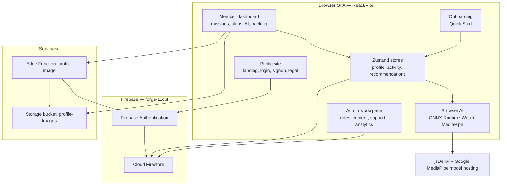

# Forge Athletic — Project Overview

**Audit date:** 2026-11-22  
**Project root:** `F:\Fitness Coach`  
**Audit type:** read-only source audit; documentation only.

---

## 1. Purpose

Forge Athletic is a premium personal-training and nutrition-coaching web application. It combines:

- A public marketing site.
- Firebase Authentication with email/password, Google sign-in, password reset, and a local demo session.
- A member dashboard covering missions, AI-generated workout plans, workout execution, AI camera form analysis, nutrition, progress, lifestyle, settings, and support.
- An administrator workspace for members, roles, fitness content, support, AI monitoring, analytics, notifications, media, and platform settings.
- Two separate browser-side AI systems:
  1. Three ONNX exercise-form classifiers (squat, bicep curl, push-up) driven by MediaPipe pose landmarks.
  2. A SmartFit-derived workout-plan classifier (24 plan classes) that selects a plan category; a deterministic TypeScript generator then builds a validated seven-day schedule.

The application is a **static single-page application**. It has no application server or REST API for member data. Firebase Firestore and Supabase Storage are accessed directly from the browser. A Supabase Edge Function exists only for privileged profile-image operations.

---

## 2. Verified technology stack

| Layer | Technology | Evidence |
|---|---|---|
| UI | React 18.3.1 | `package.json` |
| Language | TypeScript 5.6, strict mode | `package.json`, `tsconfig.json` |
| Build | Vite 6.0.3 | `vite.config.ts`, `package.json` |
| Routing | React Router DOM 6.28 | `src/App.tsx` |
| Styling | Tailwind CSS 3.4 + custom design tokens | `tailwind.config.js`, `src/index.css` |
| Components | In-project components; lucide-react icons | `src/components/**` |
| Animation | Framer Motion 11 | `package.json`, layouts |
| Charts | Recharts 2.15 | dashboard/admin pages |
| Forms | React Hook Form 7 + Zod 3 | `src/schemas`, mission form |
| State | Zustand 5 | `src/store/*` |
| Server state | TanStack React Query 5 | `src/main.tsx` (provider only; feature pages mostly use local state) |
| Auth | Firebase Auth 11 (email/password, Google popup, reset) | `src/services/authService.ts` |
| Database | Cloud Firestore (client SDK) | `src/services/cloud/*` |
| File storage | Supabase Storage + Edge Function | `src/services/cloud/storageService.ts`, `supabase/functions/profile-image/index.ts` |
| Browser AI | ONNX Runtime Web WASM + MediaPipe Tasks Vision | `src/features/ai-coach/**`, `src/features/workout-recommendation/lib/inference.ts` |
| Tests | Vitest 2; two recommendation test files | `src/features/workout-recommendation/__tests__` |
| Hosting | Static SPA rewrite configuration for Vercel | `vercel.json` |
| Firebase project | `forge-11cbf` | `.firebaserc`, `firebase.json` |

### Environment variables

Only the names below are present in `.env` / `.env.example`. Values are intentionally not reproduced.

| Variable | Purpose |
|---|---|
| `VITE_FIREBASE_API_KEY` | Firebase web client API key |
| `VITE_FIREBASE_AUTH_DOMAIN` | Firebase Auth domain |
| `VITE_FIREBASE_PROJECT_ID` | Firebase project ID |
| `VITE_FIREBASE_APP_ID` | Firebase web app ID |
| `VITE_SUPABASE_URL` | Supabase project URL |
| `VITE_SUPABASE_ANON_KEY` | Supabase publishable/anon key |
| `VITE_SUPABASE_UPLOAD_FUNCTION_URL` | Deployed profile-image Edge Function URL |
| `VITE_USE_FIREBASE_EMULATORS` | Development-only emulator switch (present in `.env.example`) |

No Firebase Admin SDK credentials, service-role keys, or email-provider secrets exist in the browser source.

---

## 3. High-level architecture

Key structural facts:

- `src/App.tsx` defines the complete route tree.
- `AuthProvider` subscribes to Firebase Auth and hydrates the profile/activity Zustand stores.
- Firestore is the system of record for signed-in non-demo users; localStorage mirrors profile, activity, and mission answers for offline/demo use.
- No Express/Next/Fastify/Nest server, API route directory, middleware pipeline, or server-side authorization layer exists in this repository.
- The only server-side code is the Supabase Edge Function for profile images.

---

## 4. Product areas and implementation status

Legend:

- **IMPLEMENTED** — route, UI, data access, and persistence exist.
- **PARTIAL** — exists but has a material gap, a disconnected data source, or a strictly client-side control.
- **PLANNED / NOT PRESENT** — no implementation in the repository.

| Area | Status | Notes |
|---|---|---|
| Public marketing site | IMPLEMENTED | Landing sections, nav, pricing, FAQ, gallery, contact CTA, legal pages |
| Email/password + Google auth | IMPLEMENTED | Firebase client SDK; no email-verification gate |
| Demo session | IMPLEMENTED | localStorage marker; demo UID `demo-athlete`; blocked from admin |
| Quick Start onboarding | IMPLEMENTED | Zod validation, profile persisted locally and to Firestore |
| My Missions | IMPLEMENTED | Seven defined missions, progress, answers persisted to Firestore + localStorage |
| Mission document upload | NOT PRESENT | Photo picker is a local preview only; no upload/storage path |
| Workout Plans | IMPLEMENTED / PARTIAL | Real AI plan shown to AI-unlocked users; sample plan remains for sample/demo path |
| AI workout recommendation | IMPLEMENTED | Real ONNX inference in browser, deterministic schedule generation, Firestore persistence |
| Recommendation backend enforcement | PLANNED | Plans are currently written by the client; rules permit owner writes |
| AI Coach (form analysis) | IMPLEMENTED | Camera/video, MediaPipe, ONNX form classifier, rep counter, session save |
| Adaptive progression | NOT PRESENT | Regeneration produces a new plan version; no load/volume adaptation from completed sessions |
| Nutrition | PARTIAL | Real meal/water logging; calorie/macro targets and example day are static sample data |
| Progress | IMPLEMENTED | Real measurements, workout frequency, AI session summaries |
| Lifestyle | IMPLEMENTED | Real sleep/stress/steps/habit logs |
| Settings | IMPLEMENTED / PARTIAL | Real preferences, photo upload, reset controls; some privacy copy is stale |
| Help Desk | IMPLEMENTED / PARTIAL | Tickets, replies, status, assignment, internal notes; no attachments |
| Notifications | IMPLEMENTED | Topbar reads Firestore notifications; admin broadcast/reply creates records |
| Admin member management | IMPLEMENTED | List, search, detail, edit name, suspend/reactivate, audit log |
| Admin roles | IMPLEMENTED | Role provisioning, role changes, activation; rules enforce role checks |
| Admin content management | PARTIAL | CRUD exists for `workoutPlans`, `exerciseLibrary`, `nutritionPlans`, but member pages do not consume those collections |
| Admin mission settings | PARTIAL | Visibility toggles are consumed by the member mission list; definitions are code-defined |
| Admin support | IMPLEMENTED | Queue, filters, ticket conversation, internal notes, status/priority/assignment |
| Admin analytics | IMPLEMENTED | Aggregates Firestore data; CSV export of visible user fields |
| Admin AI monitoring | PARTIAL | Monitors form classifiers and saved AI sessions; no monitoring for the workout-recommendation model |
| Admin media | IMPLEMENTED / PARTIAL | Reads member avatar records and storage health; no upload/delete management |
| Admin platform settings | PARTIAL | Settings persist, but maintenance message is not injected into the member app |
| Account deletion | NOT PRESENT | UI explicitly says a trusted server operation is required |
| Email/push delivery | NOT PRESENT | In-app notification records only |
| Firestore rules emulator tests | NOT PRESENT | `@firebase/rules-unit-testing` is installed; no test files exist |

---

## 5. AI systems at a glance

### 5.1 Exercise-form detection

- Artifacts: `public/models/form_classifier_squat.onnx`, `form_classifier_bicep_curl.onnx`, `form_classifier_push_up.onnx`.
- Metadata: `public/models/model_metadata.json` (60 features, classes `BAD`/`GOOD`, thresholds 0.66/0.64/0.58).
- Runtime: MediaPipe Pose Landmarker → 60-feature clip → ONNX Runtime Web (WASM).
- Executes entirely in the browser. Only session summaries are persisted.
- Held-out test accuracy is modest (squat 0.500, curl 0.500, push-up 0.625 in `ml/reports/final_metrics.json`). The UI presents it as a secondary signal.

### 5.2 Workout recommendation

- Artifact: `workout-recommendation/artifacts/workout_recommendation.onnx` (1,617,299 bytes), copied to `public/models/workout_recommendation.onnx` by `scripts/copy-model-assets.mjs`.
- Schema: `public/models/feature_schema.json` (4 numeric inputs and 5 categorical string inputs; 24 target labels).
- Model: gradient boosting, opset 17, model version 1.0.0, trained on the synthetic SmartFit dataset.
- Runtime: ONNX Runtime Web 1.31.1 WASM loaded from jsDelivr; model loaded from `/models/workout_recommendation.onnx`.
- The model predicts a plan **category**; the TypeScript generator chooses exercises, volume, schedule, and safety exclusions.
- Plans are persisted under `users/{uid}/workout_recommendations`.

---

## 6. What is real, what is sample

| Data | Source |
|---|---|
| Signed-in profile and mission progress | Firestore + localStorage |
| Mission answers | Firestore `mission_answers` + localStorage |
| AI plan | Firestore `workout_recommendations` + localStorage |
| Completed workouts | Firestore `workouts` + localStorage |
| Nutrition logs | Firestore `nutrition_logs` + localStorage |
| Measurements | Firestore `progress_records` + localStorage |
| Lifestyle and habits | Firestore `lifestyle_logs` + localStorage |
| AI Coach session summaries | Firestore `ai_sessions` + localStorage |
| Support tickets/messages | Firestore `supportTickets` |
| Notifications | Firestore `notifications` |
| Admin content records | Firestore catalog collections |
| Landing content, program marketing copy, sample workouts for non-AI users | `src/data/landing.ts`, `src/data/dashboard.ts` |
| Nutrition targets and example meals | Static `NUTRITION_TARGETS` / `DAILY_MEALS` in `src/data/dashboard.ts` |
| Recommendation exercise catalog | Static `src/features/workout-recommendation/data/exerciseLibrary.ts` |
| Workout plan templates | Static `src/features/workout-recommendation/data/planCatalog.ts` |

The application does not claim that the static content is live user data. Several pages label sample content explicitly.

---

## 7. Most important qualified statements

- The project has **no backend API**. “Backend architecture” in this repository means Firebase services plus one Supabase Edge Function, not an application server.
- Authentication and authorization are implemented with Firebase Auth and Firestore rules, plus client-side route guards. Authorization is not centralized in server middleware.
- Recommendation inference is real and browser-local. There is no server-side model enforcement, validation, or trusted plan generation.
- The SmartFit evaluation scores are perfect because the dataset is synthetic and deterministic. They are not evidence of real-world coaching effectiveness.
- Admin content CRUD is real, but several member experiences still use static TypeScript catalogs instead of the admin collections.
- Some privacy copy is stale and contradicts the current persistence behavior. This is tracked in `TECHNICAL_DEBT_AND_RECOMMENDATIONS.md`.

---

## 8. Documentation index

- [DIRECTORY_STRUCTURE.md](./DIRECTORY_STRUCTURE.md)
- [FRONTEND_ARCHITECTURE.md](./FRONTEND_ARCHITECTURE.md)
- [BACKEND_ARCHITECTURE.md](./BACKEND_ARCHITECTURE.md)
- [DATABASE_SCHEMA.md](./DATABASE_SCHEMA.md)
- [AI_ML_ARCHITECTURE.md](./AI_ML_ARCHITECTURE.md)
- [APPLICATION_WORKFLOWS.md](./APPLICATION_WORKFLOWS.md)
- [API_REFERENCE.md](./API_REFERENCE.md)
- [SECURITY_ARCHITECTURE.md](./SECURITY_ARCHITECTURE.md)
- [TECHNICAL_DEBT_AND_RECOMMENDATIONS.md](./TECHNICAL_DEBT_AND_RECOMMENDATIONS.md)
- [MASTER_PROJECT_MAP.md](./MASTER_PROJECT_MAP.md)
